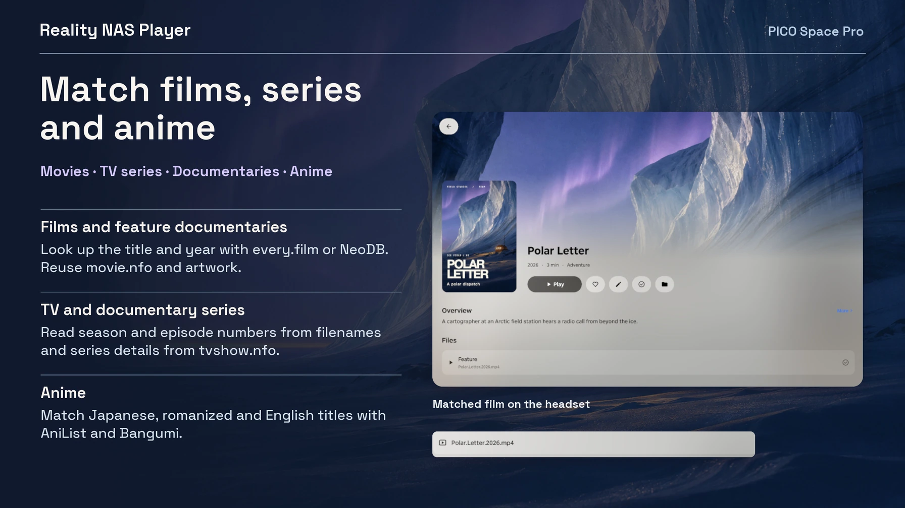

# Reality NAS Player

Identify films, organise episodes and play NAS video on **PICO Space Pro**.

**English** · [简体中文](docs/languages/zh-Hans.md) · [繁體中文](docs/languages/zh-Hant.md) · [日本語](docs/languages/ja.md) · [한국어](docs/languages/ko.md) · [Español](docs/languages/es.md) · [Deutsch](docs/languages/de.md) · [Français](docs/languages/fr.md) · [🌐 23](docs/languages/README.md)

[Download the signed APK · v1.1.0](https://github.com/jason-jm/reality-nas-player/releases/download/v1.1.0/reality-nas-player-1.1.0-6.apk) · [Product site](https://jason-jm.github.io/reality-nas-player/) · [▶ 0:31](https://jason-jm.github.io/reality-nas-player/?watch=1)

## Identify films, series, documentaries and anime

A file called video1.mkv can take its title and year from its folder. For films and feature documentaries, the player checks every.film and NeoDB without an API key. For TV and documentary series it reads season and episode numbers and existing tvshow.nfo files. Anime matching uses AniList and Bangumi. Keep your Kodi artwork and carry manual corrections into the next scan.

In the published NAS film test, the player identified **266 of 267 films** and retrieved a poster for each match. One title remained unresolved, with zero wrong film matches. [Film test and scoring rules](https://github.com/jason-jm/reality-nas-player/blob/v1.1.0/docs/keyless-verification.md)

**More online series matching is available in the v1.2.0-rc.1 preview.** It cross-checks series across public catalogues, uses broadcaster credits to identify documentary programmes, and includes an offline index of multilingual anime titles. [Preview build and release notes](https://github.com/jason-jm/reality-nas-player/releases/tag/v1.2.0-rc.1)

## Connect a share or media server

Open a NAS folder over SMB, WebDAV, NFS, FTP or SFTP. Browse DLNA devices on your network or connect a Jellyfin, Emby or Plex library.

## Browse the poster wall

Choose a cover to see the synopsis, cast and versions you own. Open a series to select a season and episode, or resume a film where you stopped.

## Play your files and choose your tracks

Video files include MKV, MP4, M4V, MOV, AVI, WebM, TS, M2TS, MTS, MPG, MPEG, MPE, M2P, M2V, VOB, WMV, ASF, RM, RMVB, FLV, F4V, OGM, OGV, DivX, 3GP. Open the main feature in compatible unencrypted Blu-ray or DVD backups (ISO, BDMV, VIDEO_TS). Subtitle formats include SRT, WebVTT, ASS/SSA, PGS, VobSub. Change tracks, adjust text size and timing, or add an external dub. Audio includes DTS and TrueHD.

Playback depends on the codec and profile inside each file, its resolution and the headset decoder. ISO, BDMV and VIDEO_TS support covers the main feature of compatible unencrypted Blu-ray and DVD backups.

## Watch in four VR cinemas

Space Lounge has five seats, including two by the windows. Switch to Private Cinema, Village Square or Desert Camp and watch the film on the room’s screen.

## Play VR180 and 360° video

Turn your head to look around. Use side-by-side or top/bottom stereo, fisheye or cubemap projection. The player reads projection metadata and lets you change the layout manually.

Download a film to the headset for offline viewing. An optional SMB share can sync watch progress, favourites and match corrections between devices. The macOS and Windows desktop app can be built from source. [Build the desktop app](docs/build.md)

[Download the signed APK · v1.1.0](https://github.com/jason-jm/reality-nas-player/releases/download/v1.1.0/reality-nas-player-1.1.0-6.apk) · [GitHub Releases](https://github.com/jason-jm/reality-nas-player/releases) · [MIT](https://github.com/jason-jm/reality-nas-player/blob/main/LICENSE) · [🌐 23](docs/languages/README.md)
