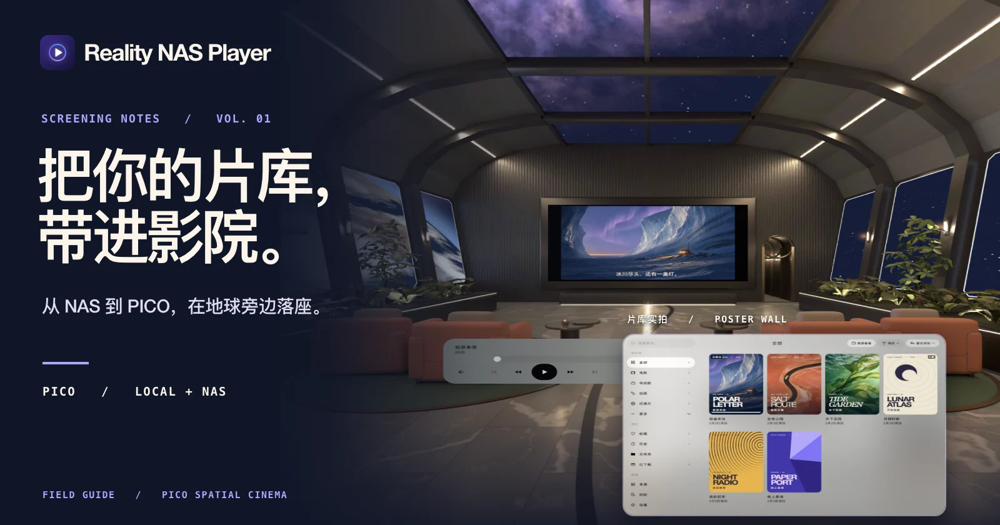
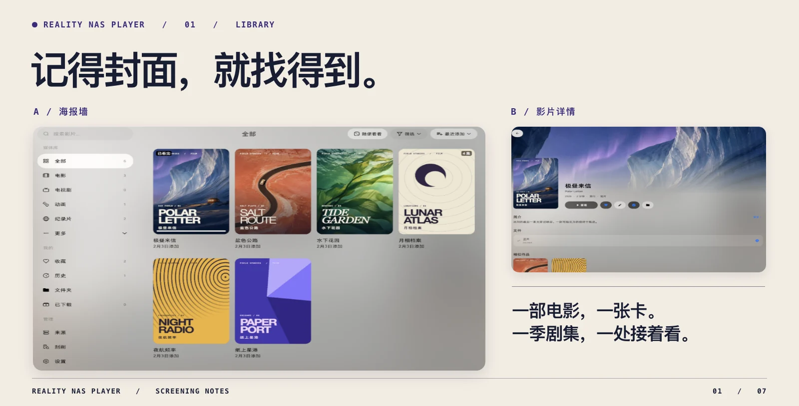
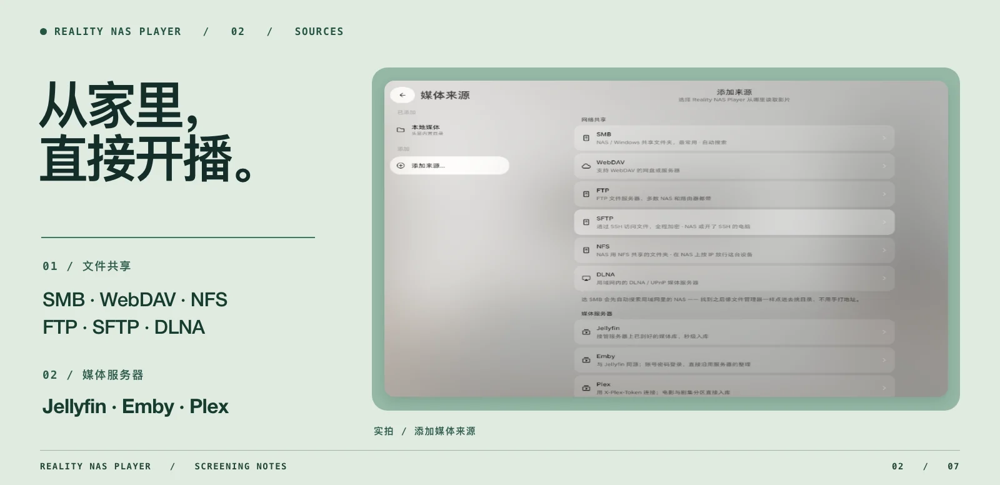
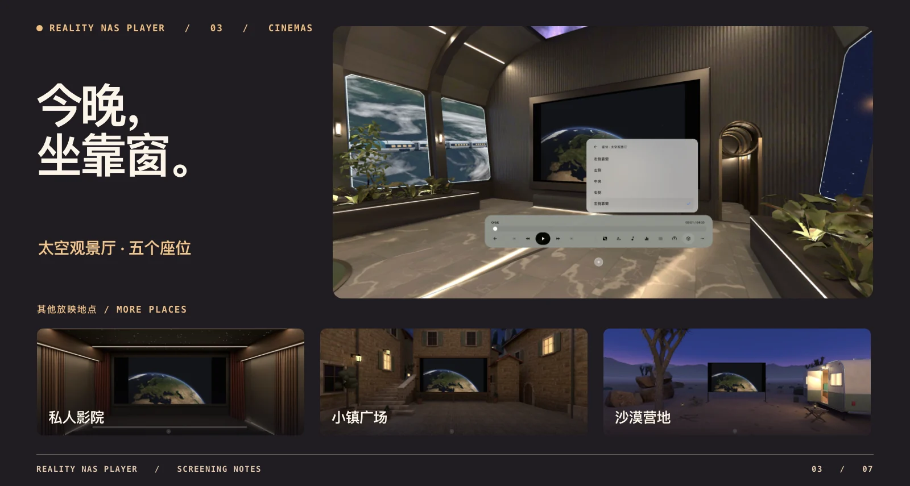
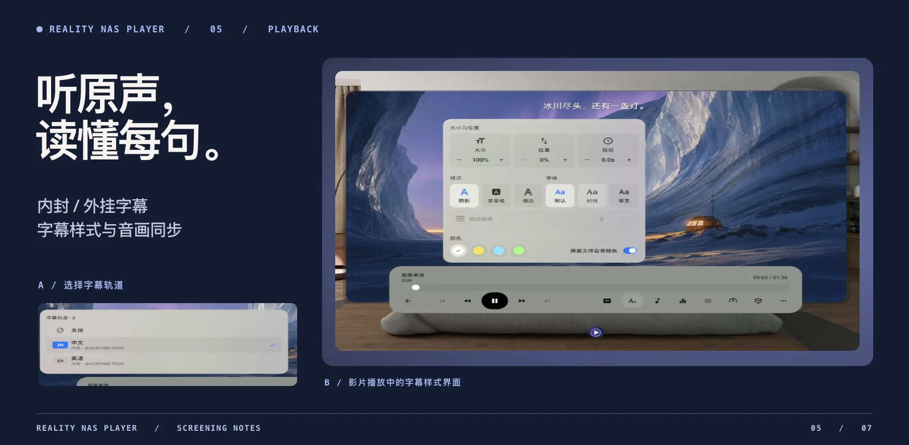
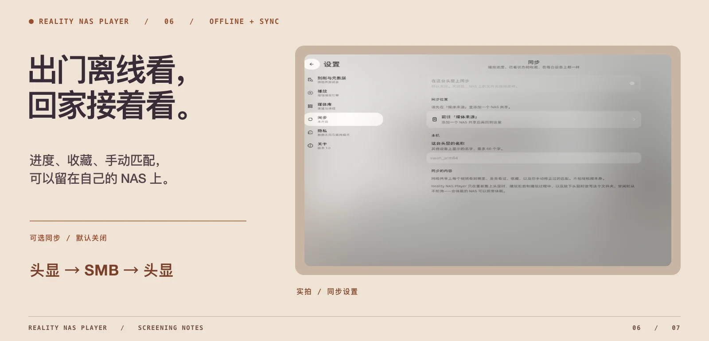
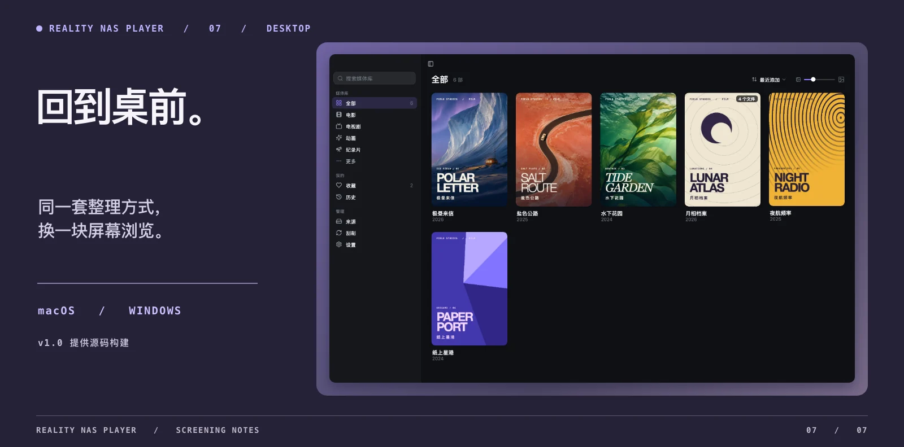

# Reality NAS Player

**简体中文** · [English](README.en.md)

**把家里的片库，带进头显里的电影院。** 影片留在 NAS、电脑或头显上；戴上 PICO，从海报墙挑一部，在太空观景厅找个靠窗的位置，接着上次看到的地方播放。用自己的影片就能开始，无需注册。

**[下载 PICO 版 v1.0（签名 APK）](https://github.com/jason-jm/reality-nas-player/releases/download/v1.0/reality-nas-player-1.0-4.apk)** · [版本说明与校验文件](https://github.com/jason-jm/reality-nas-player/releases/tag/v1.0) · [macOS / Windows 桌面端](docs/build.md)

## 从海报挑电影，从上次那集继续

记得封面，却想不起文件名？电影、剧集和动画可以按海报浏览。打开一张卡就能看片名、简介和已有的演员资料；剧集按季、集收好，「继续观看」会带你回到没看完的地方。想从收藏里挑一部还没看过的，可以按观看状态、类型或年代筛选；遇到同名片认错了，也可以自己改匹配。

已有 Kodi 风格的 `.nfo`、海报和背景图也能沿用。想补齐线上资料，可以在「设置 → 刮削与元数据」填入自己的 TMDB API Key；动画还可从 AniList、Bangumi 获取资料。不填密钥也能播放本地影片。

## 片子放在哪里，就从哪里看

电脑已经共享了电影文件夹？在「来源」选择 **SMB** 就能连接，不必为了看片再搭一套服务器。NAS 也可通过 **WebDAV、NFS、FTP 或 SFTP** 连接；局域网媒体设备可用 **DLNA**。如果家里已经在用 **Jellyfin、Emby 或 Plex**，应用里有各自的连接入口。

只有一个视频文件时，直接从头显的系统文件管理器打开即可。手机上支持 DLNA 投放的应用，还可以把视频投到同一局域网里的头显：先在设置里打开「接收投屏」。

## 今晚，想坐哪家影院？

看夜场，可以选木饰面和暗色座椅的**私人影院**；想在户外，就去**小镇广场**或**沙漠营地**。在**太空观景厅**，五个座位各有视角：坐中间正对银幕，换到窗边，地球就在身旁。私人影院和小镇广场各有三个座位，回到同一个厅还会记得你选的位置。

影片和字幕都能投到厅内银幕上。你可以调暗放映时的灯光，暂停时灯会亮回来；想兼顾眼前的房间，也能切回独立的播放窗口。

## 全景要转头看，立体片要分眼看

旅行相机拍的 **360°** 风景，可以转身看身后的山；**180° / VR180** 视频则在眼前展开。想坐着慢慢看，也可在窗口里拖动画面环顾。播放器会参考文件标记判断格式，遇到标记不准的片源，可以手动改。

收藏的 **左右（SBS）或上下（TAB）3D** 影片，在头显上可左右眼分别显示。平面电影依旧可以留在一块普通银幕上。

## 字幕、配音，按你的习惯来

看动画时保留 **ASS/SSA** 字幕的字体和排版；看外语电影，可以切换内封或外挂字幕，调整字号、位置和延迟。蓝光常见的 PGS 和 DVD 的 VobSub 图形字幕也有播放支持。同名外挂配音能与原声切换。蓝牙耳机听起来慢半拍时，直接微调音画同步，无需重新处理影片。

从 MKV、MP4 到 RMVB、WMV、AVI、Hi10P，老收藏也有播放路径。应用可解码 DTS、TrueHD 等音轨，也可从未加密的蓝光 / DVD 影片备份（ISO、BDMV、VIDEO_TS）播放正片。4K、HDR 片源的实际表现取决于编码和头显；原盘交互菜单不在 v1.0 的支持范围内。

## 出门离线看，回家接着看

出门前把影片下载到头显，断网也能看；支持续传的来源可以接着下载。家里有两台头显时，可选择自己的 **SMB 共享**同步观看进度、收藏和手动匹配。同步默认关闭；换设备后重新添加媒体来源即可使用同一份记录。

没有 Reality NAS Player 账号、广告或分析服务。片库和服务器连接信息保存在设备上；开启在线匹配时，资料服务会收到检索所需的片名等信息。也可以开启「离线刮削」，只用本地文件信息整理。应用提供 **23 种界面语言**。[隐私政策](docs/privacy-policy.md)

## 桌面上，也能逛这面海报墙

不戴头显时，也可以在 macOS 或 Windows 上用桌面端浏览海报、查看剧集详情、播放文件。桌面端与头显共用片库整理和元数据引擎；空间影院和头显选座是 PICO 版的体验。v1.0 的桌面端需[从源码构建](docs/build.md)。

## 第一次开映

1. 从 [GitHub Releases](https://github.com/jason-jm/reality-nas-player/releases/tag/v1.0) 下载 APK，侧载到兼容 PICO OS 6 的头显。
2. 打开「来源」，扫描本地视频，或选一种协议连接自己的共享文件夹。只想试播一部，也可在系统文件管理器里选择「用 Reality NAS Player 打开」。
3. 点开影片，打开播放控件里的「观影空间」，选窗口、暗场影院或虚拟环境。下次回来，在「继续观看」里接着播。

v1.0 提供 PICO 安装包；macOS、Windows 桌面端提供[源码与构建说明](docs/build.md)。播放器不附带影视内容；图中的片名与片画是为演示制作的。[海报与画面说明](docs/showcase/README.md) · [MIT 许可证](LICENSE) · [第三方许可与素材](THIRD_PARTY_NOTICES.md)
