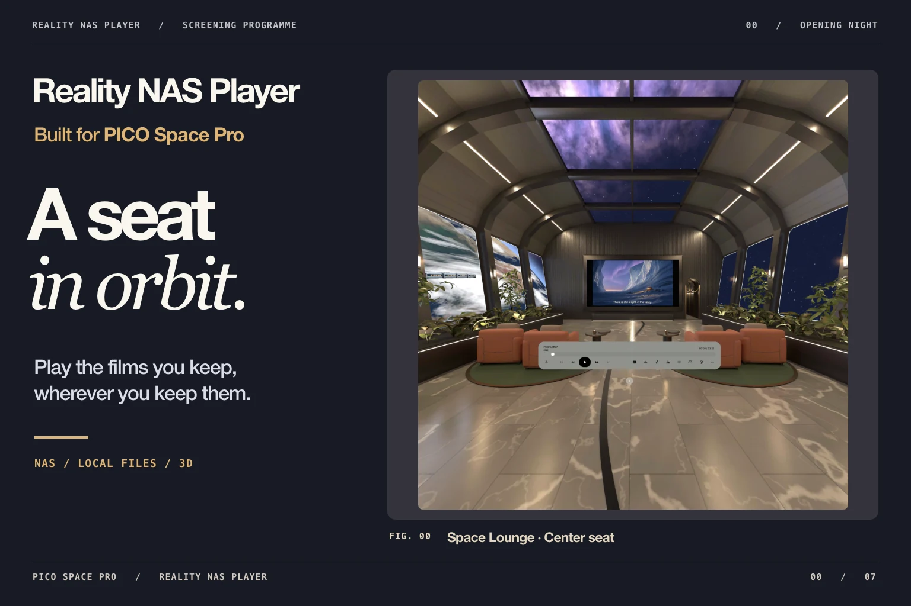

# Reality NAS Player

**Vaše soukromé kino pro PICO Space Pro.**

**Čeština** · [English](../../README.md) · [简体中文](zh-Hans.md) · [日本語](ja.md) · [Español](es.md) · [Deutsch](de.md) · [Français](fr.md)

Jazyky (23)

**Čeština** · [English](../../README.md) · [简体中文](zh-Hans.md) · [日本語](ja.md) · [Español](es.md) · [Deutsch](de.md) · [Français](fr.md) · [Dansk](da.md) · [Ελληνικά](el.md) · [Suomi](fi.md) · [Italiano](it.md) · [한국어](ko.md) · [Bahasa Melayu](ms.md) · [Norsk bokmål](nb.md) · [Nederlands](nl.md) · [Polski](pl.md) · [Português (Brasil)](pt-BR.md) · [Română](ro.md) · [Русский](ru.md) · [Svenska](sv.md) · [ไทย](th.md) · [Türkçe](tr.md) · [繁體中文](zh-Hant.md)

[Jazyky (23) →](README.md)

Filmy můžou zůstat na disku v pracovně. Nasaďte si PICO Space Pro, otevřete svou sbírku a vyberte si sedadlo s výhledem na Zemi. K přehrávání vlastních souborů nepotřebujete účet.

**[Stáhnout APK pro headset](https://github.com/jason-jm/reality-nas-player/releases/download/v1.0/reality-nas-player-1.0-4.apk)** · [Poznámky k vydání a kontrolní součty](https://github.com/jason-jm/reality-nas-player/releases/tag/v1.0) · [Sestavení pro počítač](../build.md)

## Když si pamatujete jen plakát

Procházejte sbírku podle obalů. U filmu najdete děj a obsazení, u seriálu řady a epizody. Rozkoukaný film pokračuje tam, kde jste skončili. Přehrávač využije i vaše plakáty a soubory NFO; pro údaje z TMDB můžete přidat vlastní klíč API.

## Z disku rovnou na plátno

Otevřete soubor v headsetu nebo připojte sdílenou složku přes SMB, WebDAV, NFS, FTP či SFTP. Máte doma Jellyfin, Emby, Plex nebo server DLNA? Sbírku můžete ponechat tam, kde je.

## Sedadlo u okna

V orbitálním salonku si lze vybrat z pěti míst. Další večer můžete strávit v soukromém kině, na návsi nebo v pouštním táboře. Při pauze se rozsvítí světla; k plovoucímu oknu se vrátíte přímo z přehrávání.

## Ohlédněte se za kameru

V 360° záznamu se stačí otočit. Záběry v 180° nebo VR180 se rozprostřou před vámi. Stereoskopické filmy s obrazem vedle sebe nebo nad sebou nabídnou každému oku vlastní pohled.

## Hlas i titulky podle vás

Přepínejte dabing a originál, dolaďte zpoždění zvuku nebo načtěte externí titulky. Podporovány jsou ASS/SSA i obrazové PGS a VobSub. Z nešifrované zálohy Blu-ray či DVD lze přehrát hlavní film bez nabídky disku.

## Na cestu bez sítě

Před odjezdem si film stáhněte do headsetu. Doma můžete přes zvolenou složku SMB synchronizovat průběh sledování, oblíbené položky a opravené názvy. Přehrávač nezobrazuje reklamy ani nesbírá analytická data.

## Když sedíte u počítače

Na macOS a Windows lze knihovnu procházet a filmy přehrávat myší a klávesnicí. Prostorová kina patří k headsetu. Verze 1.0 nabízí podepsaný APK; aplikace pro počítač se sestavuje ze zdrojového kódu.

## První promítání

Nainstalujte APK do PICO Space Pro, otevřete vlastní video a v ovládání přehrávání zvolte prostředí. Snímky z headsetu pocházejí z emulátoru PICO OS 6. Ukázkové filmy nejsou součástí aplikace.

[Ochrana soukromí](../privacy-policy.md) · [O snímcích](../showcase/README.md) · [MIT](../../LICENSE) · [Jazyky (23)](README.md)
