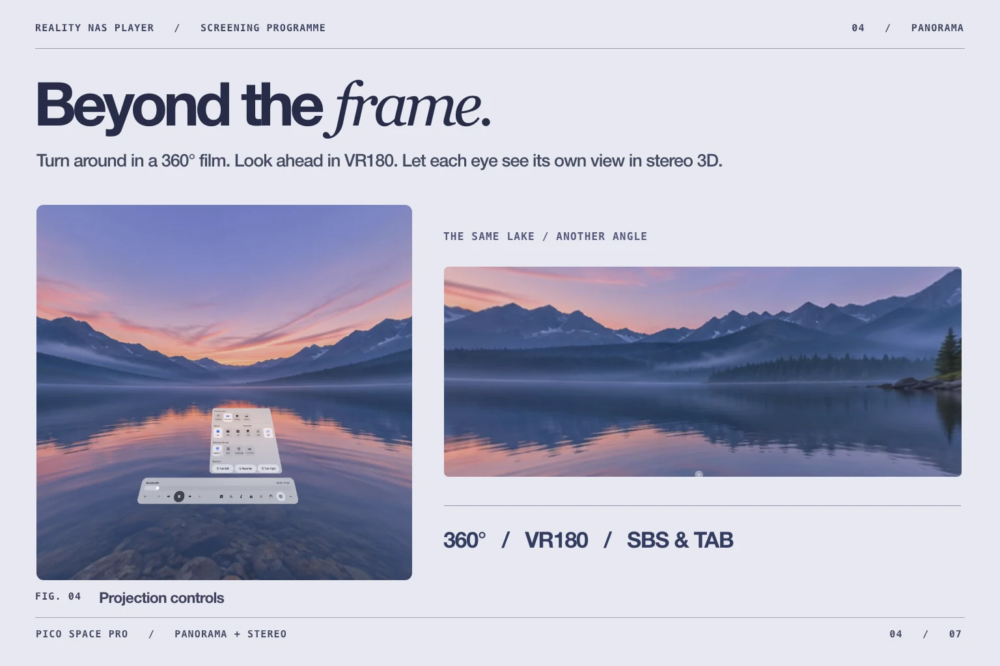

# Reality NAS Player

**Din egen biograf, skabt til PICO Space Pro.**

**Dansk** · [English](../../README.md) · [简体中文](zh-Hans.md) · [日本語](ja.md) · [Español](es.md) · [Deutsch](de.md) · [Français](fr.md)

Sprog (23)

**Dansk** · [English](../../README.md) · [简体中文](zh-Hans.md) · [日本語](ja.md) · [Español](es.md) · [Deutsch](de.md) · [Français](fr.md) · [Čeština](cs.md) · [Ελληνικά](el.md) · [Suomi](fi.md) · [Italiano](it.md) · [한국어](ko.md) · [Bahasa Melayu](ms.md) · [Norsk bokmål](nb.md) · [Nederlands](nl.md) · [Polski](pl.md) · [Português (Brasil)](pt-BR.md) · [Română](ro.md) · [Русский](ru.md) · [Svenska](sv.md) · [ไทย](th.md) · [Türkçe](tr.md) · [繁體中文](zh-Hant.md)

[Sprog (23) →](README.md)

Lad filmen ligge på din NAS. Tag headsettet på, vælg en vinduesplads med udsigt til Jorden, og se videre dér, hvor du stoppede. Dine egne filer kræver ingen konto hos afspilleren.

**[Hent APK til headset](https://github.com/jason-jm/reality-nas-player/releases/download/v1.0/reality-nas-player-1.0-4.apk)** · [Versionsnoter og kontrolsummer](https://github.com/jason-jm/reality-nas-player/releases/tag/v1.0) · [Byg computerappen](../build.md)

## Find filmen på plakaten

Bladr i plakaterne, se handling og medvirkende, eller find næste afsnit efter sæson. Du kan beholde dine Kodi-NFO-filer og billeder. En personlig API-nøgle er kun nødvendig, hvis du vil hente oplysninger fra TMDB.

## Brug det lager, du har

Åbn en lokal fil eller en delt mappe på computeren via SMB. WebDAV, NFS, FTP og SFTP virker også, ligesom Jellyfin, Emby, Plex og DLNA. Slå DLNA-modtagelse til, hvis du vil sende video fra en kompatibel telefon.

## Vælg din plads

Rumloungen har fem pladser. Du kan også se film i privatbiografen, på landsbytorvet eller i ørkenlejren. Rummet husker din plads, og lyset tændes ved pause. Et svævende vindue er et alternativ.

## Se dig omkring

Drej hovedet i en 360°-video, eller udforsk scenen foran dig i 180° og VR180. I et vindue kan du trække for at kigge rundt. I 3D-film med billeder ved siden af eller over hinanden får hvert øje sin egen visning.

## Lyd og undertekster

Skift lydspor eller ekstern dubbing, juster lydforsinkelsen, og brug ASS/SSA-, PGS- eller VobSub-undertekster. Du kan også se hovedfilmen fra en ukrypteret Blu-ray- eller DVD-kopi uden diskmenuer, samt MKV, MP4 og ældre formater. 4K og HDR afhænger af fil og enhed.

## Tag filmen med

Hent en film, før du forlader dit wi-fi. Et SMB-drev efter eget valg kan synkronisere afspilningsposition, favoritter og rettede titler mellem headset. Ingen reklamer eller brugsanalyse; offlinegenkendelse benytter lokale filoplysninger.

## Ved skrivebordet

På macOS og Windows kan du finde og afspille film med mus og tastatur. De virtuelle sale hører til headsettet. v1.0 leveres som APK til headsettet; computerappen bygges fra kildekoden.

## Første forestilling

Installer APK-filen på PICO Space Pro, åbn en egen video eller tilføj en delt mappe, og vælg visningsrum i afspilleren. Billederne er optaget i PICO OS 6-emulatoren. Demofilmene følger ikke med.

[Privatliv](../privacy-policy.md) · [Om billederne](../showcase/README.md) · [MIT](../../LICENSE) · [Sprog (23)](README.md)
