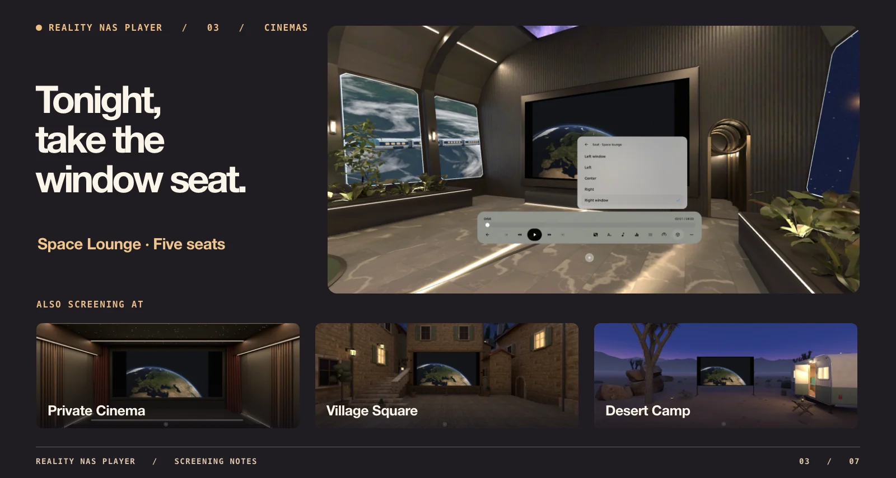

# Reality NAS Player

**Das persönliche Kino für PICO Space Pro.**

**Deutsch** · [English](../../README.md) · [简体中文](zh-Hans.md) · [日本語](ja.md) · [Español](es.md) · [Français](fr.md)

Sprachen (23)

**Deutsch** · [English](../../README.md) · [简体中文](zh-Hans.md) · [日本語](ja.md) · [Español](es.md) · [Français](fr.md) · [Čeština](cs.md) · [Dansk](da.md) · [Ελληνικά](el.md) · [Suomi](fi.md) · [Italiano](it.md) · [한국어](ko.md) · [Bahasa Melayu](ms.md) · [Norsk bokmål](nb.md) · [Nederlands](nl.md) · [Polski](pl.md) · [Português (Brasil)](pt-BR.md) · [Română](ro.md) · [Русский](ru.md) · [Svenska](sv.md) · [ไทย](th.md) · [Türkçe](tr.md) · [繁體中文](zh-Hant.md)

[Sprachen (23) →](README.md)

Öffne die Film-, Serien- und Anime-Ordner, die sich über die Jahre auf deinem NAS angesammelt haben. Reality NAS Player erkennt Titel, ordnet Folgen und legt Extras zur passenden Serie. Auf **PICO Space Pro** wählst du ein Cover und nimmst mit Blick auf die Erde Platz.

**[Headset-APK herunterladen](https://github.com/jason-jm/reality-nas-player/releases/download/v1.1.0/reality-nas-player-1.1.0-6.apk)** · [Versionshinweise und Prüfsummen](https://github.com/jason-jm/reality-nas-player/releases/tag/v1.1.0) · [Desktop-App bauen](../build.md)

## Aus NAS-Ordnern werden Filmeinträge

**Der Ordner liefert den fehlenden Hinweis.** Bei `Interstellar (2014)/video1.mkv` verrät der übergeordnete Ordner Titel und Jahr. Auch `Dark Staffel 2 Folge 3.mkv` landet an der richtigen Stelle. Für die Suche zieht der Player Originaltitel und regionale Verleihtitel heran.

Fansub-Dateien tragen oft Kürzel. Heißt eine Folge nur `Seitokai`, kann eine andere im selben Ordner den vollständigen Namen für die Suche bei AniList liefern. Ein Kinofilm kann ein eigenes Cover bekommen, während Vor- und Abspänne ohne Texteinblendungen unter den Extras der Serie landen. Mehrere Fassungen desselben Films lassen sich über einen einzigen Eintrag auswählen.

Ein Kodi-NFO mit TMDB-ID liefert bei Filmen und Serien auch offline die darin gespeicherte Handlung und Besetzung. Poster und Hintergrundbilder können aus deinem Ordner stammen. Beim Scannen erkennt der Player Filme anhand von Titel und Erscheinungsjahr und lädt verfügbare Poster und Inhaltsangaben. Dafür brauchst du weder Konto noch API-Schlüssel. Eine falsche Zuordnung korrigierst du für die gesamte Serienkarte. Die Auswahl bleibt beim nächsten Scan erhalten.

[Beispiele und die zugehörigen Open-Source-Tests ansehen (Englisch)](../metadata-matching.md)

## Durch die Filmplakate stöbern

  

Dir fällt nur noch das blaue Plakat ein? Auf der Posterwand erkennst du den Film wieder. Öffne das Cover für Hintergrundbild, Handlung und Besetzung oder wähle bei Serien Staffel und Folge. Filtere nach Genre oder Jahrzehnt und setze angefangene Filme an der letzten Stelle fort.

## Die vorhandene Sammlung anschließen

Öffne eine Datei auf dem Headset oder greife per SMB auf einen freigegebenen Ordner zu. WebDAV, NFS, FTP, SFTP sowie Jellyfin, Emby, Plex und DLNA werden ebenfalls unterstützt. Den DLNA-Empfänger für ein kompatibles Smartphone kannst du bei Bedarf einschalten.

## Ein Platz am Fenster

In der Weltraumlounge gibt es fünf Plätze. Weitere Schauplätze sind das Privatkino, der Dorfplatz und das Wüstencamp. Der Raum merkt sich deinen Sitzplatz. Beim Pausieren geht das Licht an; alternativ läuft der Film in einem schwebenden Fenster.

## Ein Blick über die Schulter

In 360°-Aufnahmen kannst du dich umdrehen, in 180° und VR180 liegt die Szene vor dir. Im Fenster lässt sich der Blick durch Ziehen bewegen. 3D-Filme mit Bildern nebeneinander oder übereinander zeigen jedem Auge eine eigene Ansicht. Das Format lässt sich von Hand korrigieren.

## Die passende Ton- und Untertitelspur

Wähle Originalton oder externe Synchronfassung, gleiche Tonversatz aus und nutze ASS/SSA-, PGS- oder VobSub-Untertitel. Neben MKV, MP4 und älteren Formaten spielt der Player den Hauptfilm unverschlüsselter Blu-ray- und DVD-Sicherungen ab, ohne Disc-Menüs. 4K und HDR hängen von Datei und Gerät ab.

## Ein Film für unterwegs

Lade den Film vor der Reise auf das Headset. Über eine eigene SMB-Freigabe kannst du Wiedergabestand, Favoriten und manuelle Titelzuordnungen zwischen Headsets abgleichen. Der Abgleich ist freiwillig. Es gibt keine Werbung oder Nutzungsanalyse; die Offline-Erkennung arbeitet mit lokalen Angaben.

## Wieder am Schreibtisch

Unter macOS und Windows lässt sich die Sammlung mit Maus und Tastatur durchsuchen und abspielen. Die räumlichen Kinos gehören zur Headset-Version. v1.1.0 enthält eine Headset-APK; die Desktop-App wird aus dem Quellcode gebaut.

## Die erste Vorstellung

Installiere die APK auf PICO Space Pro, öffne eine eigene Videodatei oder füge eine Freigabe hinzu und wähle in der Wiedergabesteuerung den Raum. Die Headset-Bilder stammen aus dem Emulator für PICO OS 6. Die Beispielfilme sind nicht enthalten.

[Datenschutz](../privacy-policy.md) · [Zu den Bildern](../showcase/README.md) · [MIT](../../LICENSE) · [Sprachen (23)](README.md)
