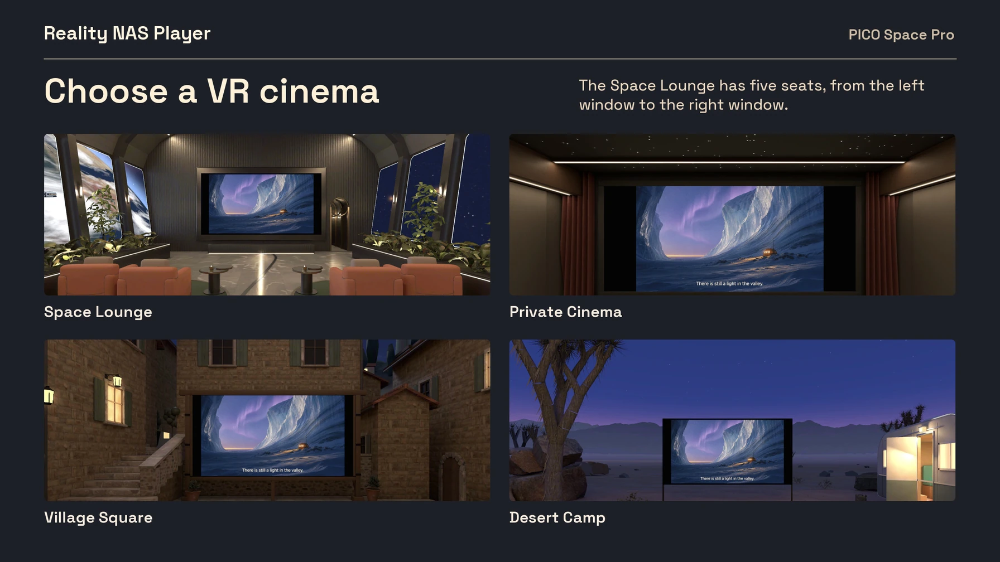

# Reality NAS Player

Identifiez vos films et classez les séries de votre NAS sur **PICO Space Pro**.

[English](../../README.md) · [简体中文](zh-Hans.md) · [繁體中文](zh-Hant.md) · [日本語](ja.md) · [한국어](ko.md) · [Español](es.md) · [Deutsch](de.md) · **Français** · [🌐 23](README.md)

[Télécharger l’APK signé · v1.2.0](https://github.com/jason-jm/reality-nas-player/releases/download/v1.2.0/reality-nas-player-1.2.0-8.apk) · [Web](https://jason-jm.github.io/reality-nas-player/) · [▶ 0:31](https://jason-jm.github.io/reality-nas-player/?watch=1)

## Identifier films, séries, documentaires et anime

Un dossier peut donner un titre et une année à video1.mkv. Pour les films, y compris les documentaires unitaires, la recherche interroge every.film et NeoDB sans clé API. Pour les séries et documentaires en épisodes, elle lit la saison, le numéro d’épisode et les fichiers tvshow.nfo existants. AniList et Bangumi servent à identifier les anime. Les affiches Kodi et les corrections manuelles sont conservées.

## Accéder au NAS ou au serveur multimédia

Ouvrez un dossier partagé en SMB, WebDAV, NFS, FTP ou SFTP. Parcourez un appareil DLNA du réseau ou connectez votre bibliothèque Jellyfin, Emby ou Plex.

## Choisir sur le mur d’affiches

Ouvrez une affiche pour voir le résumé, la distribution et vos différentes versions. Sélectionnez une saison et un épisode ou reprenez un film là où vous l’aviez arrêté.

## Formats vidéo, sous-titres et son

Les formats vidéo reconnus comprennent MKV, MP4, M4V, MOV, AVI, WebM, TS, M2TS, MTS, MPG, MPEG, MPE, M2P, M2V, VOB, WMV, ASF, RM, RMVB, FLV, F4V, OGM, OGV, DivX, 3GP. Lancez le film principal d’une copie Blu-ray ou DVD compatible et non chiffrée (ISO, BDMV, VIDEO_TS). Les sous-titres acceptés comprennent SRT, WebVTT, ASS/SSA, PGS, VobSub. Changez de piste, réglez taille du texte et décalage ou ajoutez un doublage externe. Lecture des pistes DTS et TrueHD.

## Quatre salles en VR

Le salon spatial propose cinq places, dont deux près des hublots. Vous pouvez aussi projeter le film dans le cinéma privé, sur la place du village ou au camp dans le désert.

## Vidéo VR180 et à 360°

Tournez la tête pour explorer la scène. La lecture gère la stéréo côte à côte ou haut/bas, les projections fisheye et cubiques. Reprenez la projection indiquée dans le fichier ou réglez-la manuellement.

[Télécharger l’APK signé · v1.2.0](https://github.com/jason-jm/reality-nas-player/releases/download/v1.2.0/reality-nas-player-1.2.0-8.apk) · [GitHub Releases](https://github.com/jason-jm/reality-nas-player/releases) · [MIT](https://github.com/jason-jm/reality-nas-player/blob/main/LICENSE) · [🌐 23](README.md)
