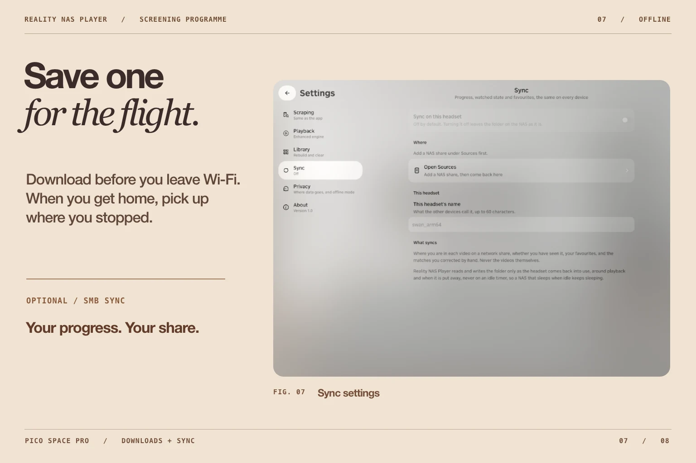

# Reality NAS Player

**La tua sala cinematografica, progettata per PICO Space Pro.**

**Italiano** · [English](../../README.md) · [简体中文](zh-Hans.md) · [日本語](ja.md) · [Español](es.md) · [Deutsch](de.md) · [Français](fr.md)

Lingue (23)

**Italiano** · [English](../../README.md) · [简体中文](zh-Hans.md) · [日本語](ja.md) · [Español](es.md) · [Deutsch](de.md) · [Français](fr.md) · [Čeština](cs.md) · [Dansk](da.md) · [Ελληνικά](el.md) · [Suomi](fi.md) · [한국어](ko.md) · [Bahasa Melayu](ms.md) · [Norsk bokmål](nb.md) · [Nederlands](nl.md) · [Polski](pl.md) · [Português (Brasil)](pt-BR.md) · [Română](ro.md) · [Русский](ru.md) · [Svenska](sv.md) · [ไทย](th.md) · [Türkçe](tr.md) · [繁體中文](zh-Hant.md)

[Lingue (23) →](README.md)

Collega le cartelle di film e serie del NAS a PICO Space Pro. Reality NAS Player riconosce i titoli e prepara la libreria. Scegli una locandina e accomodati in sala con vista sulla Terra.

**[Scarica l’APK per il visore](https://github.com/jason-jm/reality-nas-player/releases/download/v1.0/reality-nas-player-1.0-4.apk)** · [Note di rilascio e checksum](https://github.com/jason-jm/reality-nas-player/releases/tag/v1.0) · [Compila l’app desktop](../build.md)

## Dalle cartelle del NAS alle schede dei film

Aggiungi una cartella condivisa e avvia la scansione. Il lettore identifica film ed episodi dal nome del file, dall’anno e dal numero di stagione e puntata. Legge gli ID nei file NFO di Kodi e usa locandine e sfondi salvati accanto ai video. Nell’immagine, trama e cast di Polar Letter provengono dal file NFO di una condivisione WebDAV, letto senza ricerche online. Per cercare su TMDB puoi inserire la tua chiave API. Puoi anche correggere un abbinamento a mano.

## Sfoglia la libreria dalle locandine

Ti ricordi la locandina blu ma non il titolo? Apri il film dal mosaico di copertine per ritrovare sfondo, trama e interpreti. Per una serie scegli stagione ed episodio. Puoi filtrare per genere o decennio e riprendere un film dalla scena che avevi lasciato.

## Collega l’archivio che hai già

Apri un video dal visore o una cartella condivisa sul computer tramite SMB. Sono disponibili anche WebDAV, NFS, FTP, SFTP, Jellyfin, Emby, Plex e DLNA. Per inviare video da un telefono compatibile attiva il ricevitore DLNA.

## Scegli la sala e il posto

Il salone spaziale ha cinque posti, anche vicino ai finestrini. Puoi scegliere il cinema privato, la piazza del borgo o il campo nel deserto. La sala ricorda dove eri seduto e le luci si riaccendono in pausa. Puoi anche guardare in una finestra sospesa.

## Guarda oltre l’inquadratura

Girati in un video a 360° o esplora la scena davanti a te in 180° o VR180. In finestra puoi trascinare la vista. Nei film 3D con immagini affiancate o sovrapposte ogni occhio riceve la propria immagine; il formato si può impostare a mano.

## La traccia che preferisci

Scegli fra audio originale e doppiaggio esterno, regola il ritardo audio e usa sottotitoli ASS/SSA, PGS o VobSub. Oltre a MKV, MP4 e diversi vecchi formati, puoi riprodurre il film principale dei backup Blu-ray o DVD non cifrati, senza i menu del disco. 4K e HDR dipendono dal file e dal dispositivo.

## Porta un film in viaggio

Scaricalo sul visore prima di lasciare il Wi-Fi. Una condivisione SMB facoltativa può sincronizzare posizione, preferiti e abbinamenti corretti tra visori. Niente pubblicità né analisi d’uso; il riconoscimento offline usa i dati locali.

## Anche alla scrivania

Su macOS e Windows puoi sfogliare la raccolta e riprodurre i file con mouse e tastiera. Le sale virtuali sono un’esperienza del visore. La v1.0 offre l’APK per il visore; l’app desktop si compila dai sorgenti.

## La prima proiezione

Installa l’APK su PICO Space Pro, apri un tuo video o aggiungi una cartella condivisa, poi scegli l’ambiente dai controlli di riproduzione. Le immagini del visore provengono dall’emulatore PICO OS 6. I film dimostrativi non sono inclusi.

[Privacy](../privacy-policy.md) · [Informazioni sulle immagini](../showcase/README.md) · [MIT](../../LICENSE) · [Lingue (23)](README.md)
