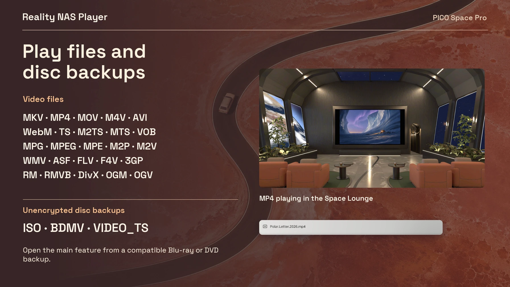

# Reality NAS Player

Identifica i film, ordina gli episodi e riproduci i video NAS su **PICO Space Pro**.

[English](../../README.md) · [简体中文](zh-Hans.md) · [繁體中文](zh-Hant.md) · [日本語](ja.md) · [한국어](ko.md) · [Español](es.md) · [Deutsch](de.md) · [Français](fr.md) · [🌐 23](README.md)

[Scarica l’APK firmato · v1.2.1](https://github.com/jason-jm/reality-nas-player/releases/download/v1.2.1/reality-nas-player-1.2.1-9.apk) · [Web](https://jason-jm.github.io/reality-nas-player/) · [▶ 0:31](https://jason-jm.github.io/reality-nas-player/?watch=1)

## Riconoscimento di film, serie, documentari e anime

Anche per video1.mkv la cartella può indicare titolo e anno. Per film e documentari in un’unica parte vengono consultati every.film e NeoDB senza chiave API. Per serie TV e documentari a puntate si leggono stagione, episodio e file tvshow.nfo esistenti. Gli anime vengono confrontati con AniList e Bangumi. Le locandine Kodi e le correzioni manuali restano nella raccolta.

## Collegamento a NAS e server multimediali

Apri una cartella condivisa con SMB, WebDAV, NFS, FTP o SFTP. Sfoglia i dispositivi DLNA in rete o collega una libreria Jellyfin, Emby o Plex.

## Scegli dalla parete di locandine

Apri una locandina per vedere trama, cast e versioni in tuo possesso. Per le serie scegli stagione ed episodio. I film ripartono dal punto in cui li hai interrotti.

## Formati video, sottotitoli e audio

I file riconosciuti comprendono MKV, MP4, M4V, MOV, AVI, WebM, TS, M2TS, MTS, MPG, MPEG, MPE, M2P, M2V, VOB, WMV, ASF, RM, RMVB, FLV, F4V, OGM, OGV, DivX, 3GP. Riproduci il titolo principale dei backup Blu-ray e DVD compatibili e non cifrati (ISO, BDMV, VIDEO_TS). I formati dei sottotitoli includono SRT, WebVTT, ASS/SSA, PGS, VobSub. Cambia traccia, regola dimensioni e sincronizzazione o aggiungi un doppiaggio esterno. L’audio include DTS e TrueHD.

## Quattro sale VR

La lounge spaziale offre cinque posti, due vicino alle finestre. Puoi proiettare il film anche nel cinema privato, in piazza del borgo o al campo nel deserto.

## Video VR180 e a 360°

Guardati intorno muovendo la testa. Sono gestiti lo stereo affiancato o sovrapposto, il fisheye e le mappe cubiche. Usa la proiezione indicata nel file o impostala a mano.

[Scarica l’APK firmato · v1.2.1](https://github.com/jason-jm/reality-nas-player/releases/download/v1.2.1/reality-nas-player-1.2.1-9.apk) · [GitHub Releases](https://github.com/jason-jm/reality-nas-player/releases) · [MIT](https://github.com/jason-jm/reality-nas-player/blob/main/LICENSE) · [🌐 23](README.md)
