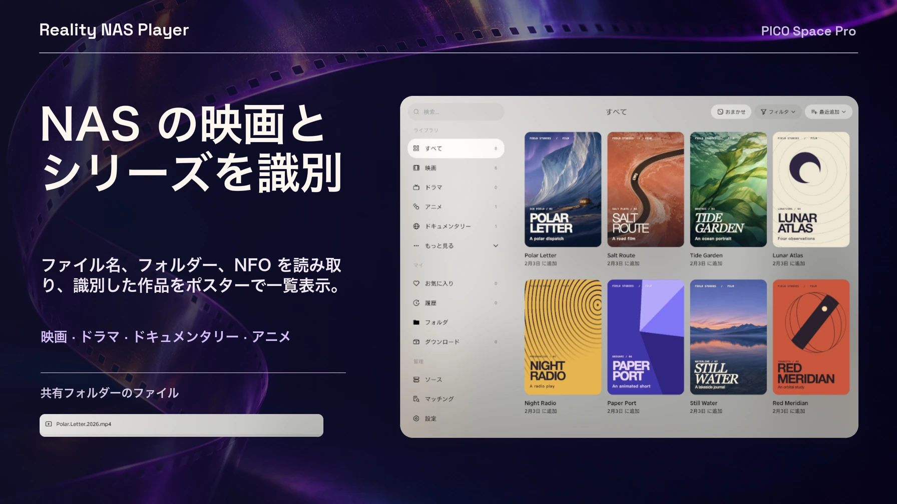
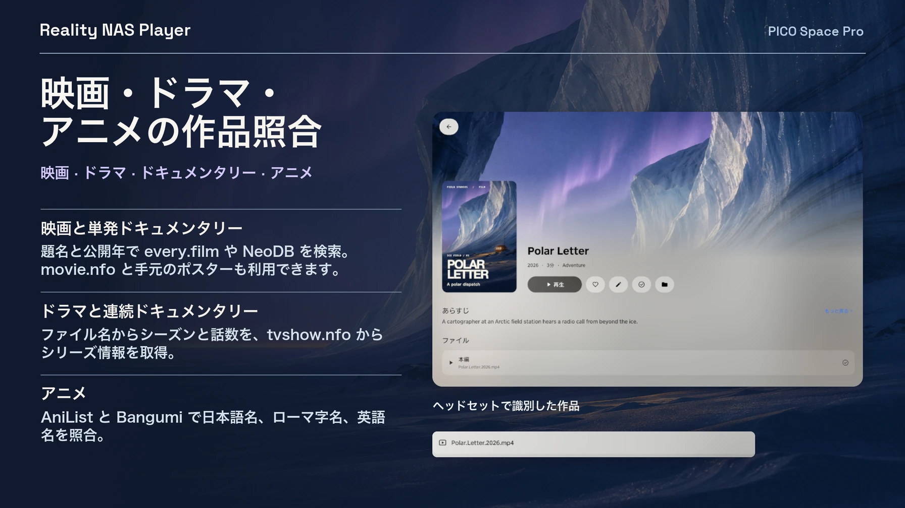
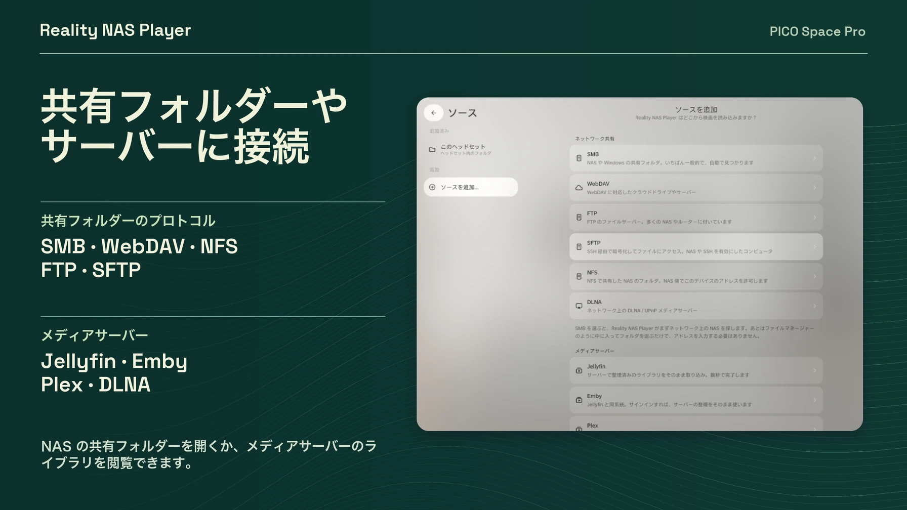
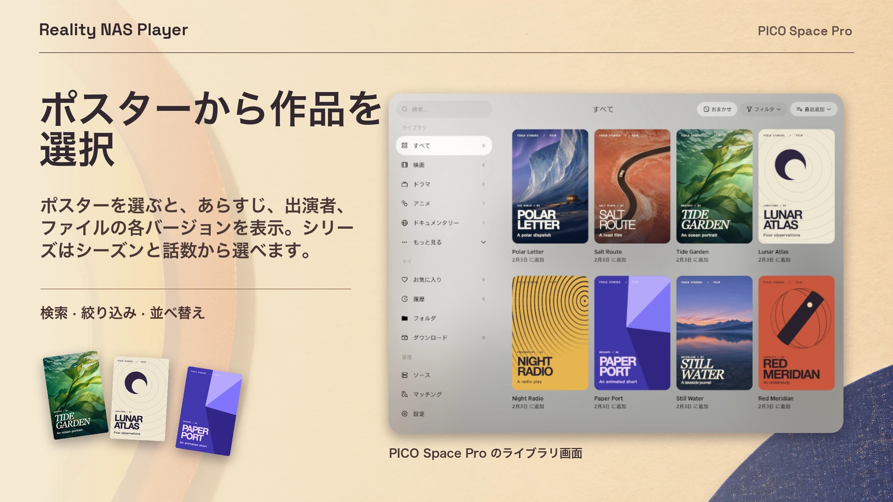
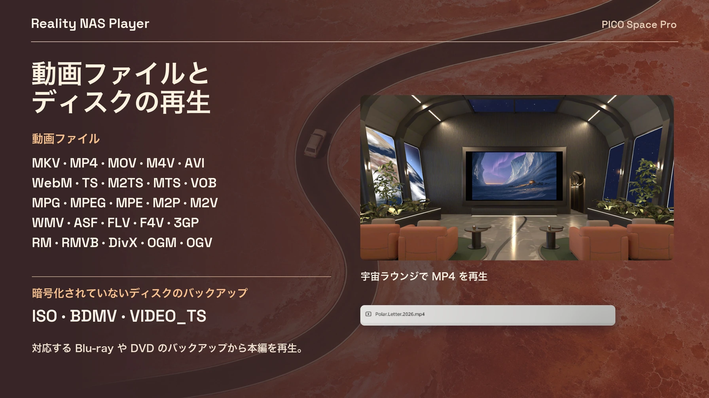
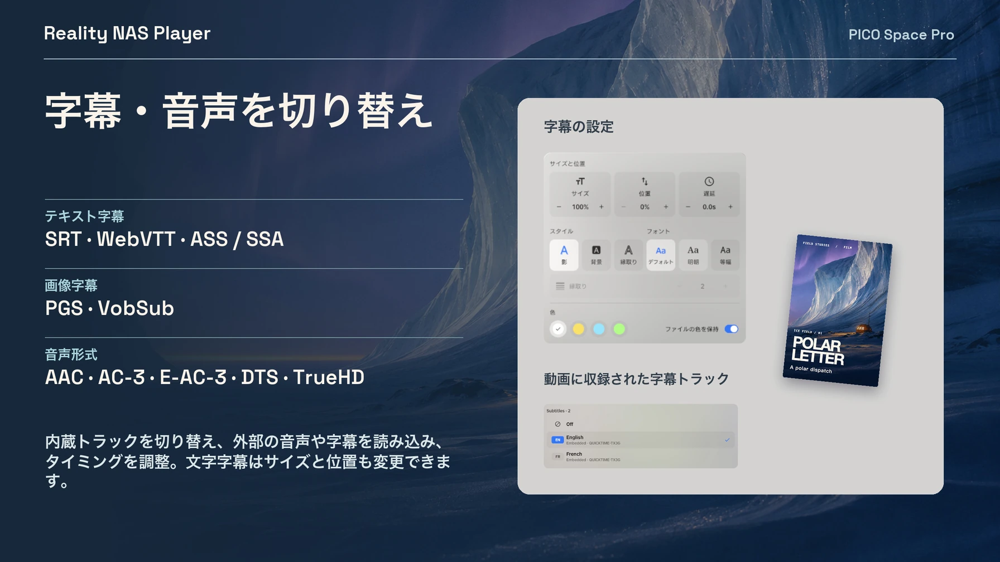
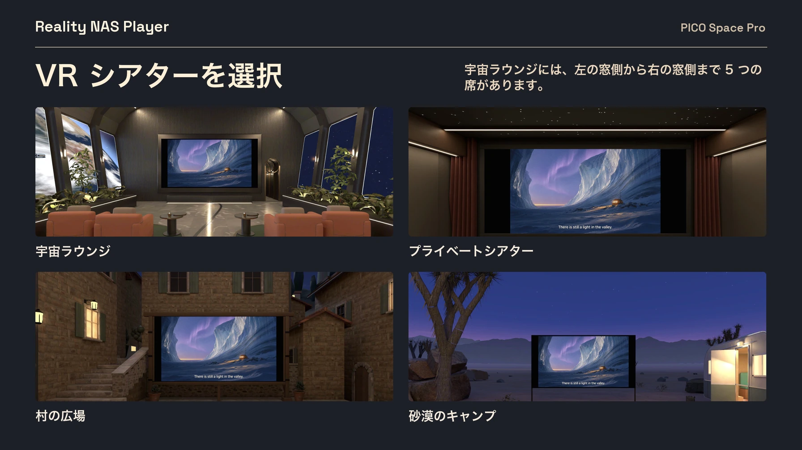
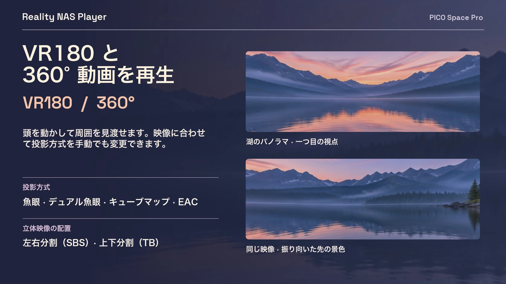

# Reality NAS Player

**PICO Space Pro**で映画やアニメの作品情報を取得し、ポスターから動画やエピソードを選んで再生。

[English](../../README.md) · [简体中文](zh-Hans.md) · [繁體中文](zh-Hant.md) · **日本語** · [한국어](ko.md) · [Español](es.md) · [Deutsch](de.md) · [Français](fr.md) · [🌐 23](README.md)

[署名済み APK をダウンロード · v1.1.0](https://github.com/jason-jm/reality-nas-player/releases/download/v1.1.0/reality-nas-player-1.1.0-6.apk) · [公式サイト](https://jason-jm.github.io/reality-nas-player/) · [▶ 0:31](https://jason-jm.github.io/reality-nas-player/?watch=1)

## 映画、ドラマ、ドキュメンタリー、アニメの作品情報

ファイル名がvideo1.mkvでも、親フォルダーの作品名と公開年を照合に使えます。映画や単発のドキュメンタリーはevery.filmやNeoDBからAPIキーなしで検索。連続ドラマやドキュメンタリーシリーズはシーズンと話数で整理し、既存のtvshow.nfoも読み取ります。アニメはAniListとBangumiで照合。Kodiのポスターや手動の修正内容も引き継ぎます。

## NASとメディアサーバーに接続

共有フォルダーはSMB、WebDAV、NFS、FTP、SFTPで開けます。家庭内のDLNA機器を参照したり、Jellyfin、Emby、Plexのライブラリに接続したりできます。

## ポスターから作品とエピソードを選ぶ

ポスターを開くと、あらすじ、キャスト、手元にある別バージョンを確認できます。シリーズはシーズンから話数を選択。途中まで見た映画は前回の位置から再開できます。

## 動画形式、字幕と音声トラック

読み込める動画ファイルは MKV, MP4, M4V, MOV, AVI, WebM, TS, M2TS, MTS, MPG, MPEG, MPE, M2P, M2V, VOB, WMV, ASF, RM, RMVB, FLV, F4V, OGM, OGV, DivX, 3GP。対応する暗号化されていないBlu-ray・DVDのバックアップ（ISO、BDMV、VIDEO_TS）から本編を再生できます。字幕はSRT、WebVTT、ASS/SSA、PGS、VobSubに対応。字幕の切り替え、文字サイズや表示タイミングの調整、音声切り替えや外部吹替音声の追加ができます。DTS、TrueHDにも対応します。

## 4つのVRシアター

宇宙ラウンジには窓際を含む5席があります。プライベートシアター、村の広場、砂漠のキャンプでも、各空間のスクリーンに映画を映せます。

## VR180と360°動画の再生

頭を動かして映像を見回せます。左右分割・上下分割の立体視、魚眼、キューブマップに対応。ファイルの投影情報を読み取り、必要に応じて投影方式を手動で変更できます。

[署名済み APK をダウンロード · v1.1.0](https://github.com/jason-jm/reality-nas-player/releases/download/v1.1.0/reality-nas-player-1.1.0-6.apk) · [GitHub Releases](https://github.com/jason-jm/reality-nas-player/releases) · [MIT](https://github.com/jason-jm/reality-nas-player/blob/main/LICENSE) · [🌐 23](README.md)
