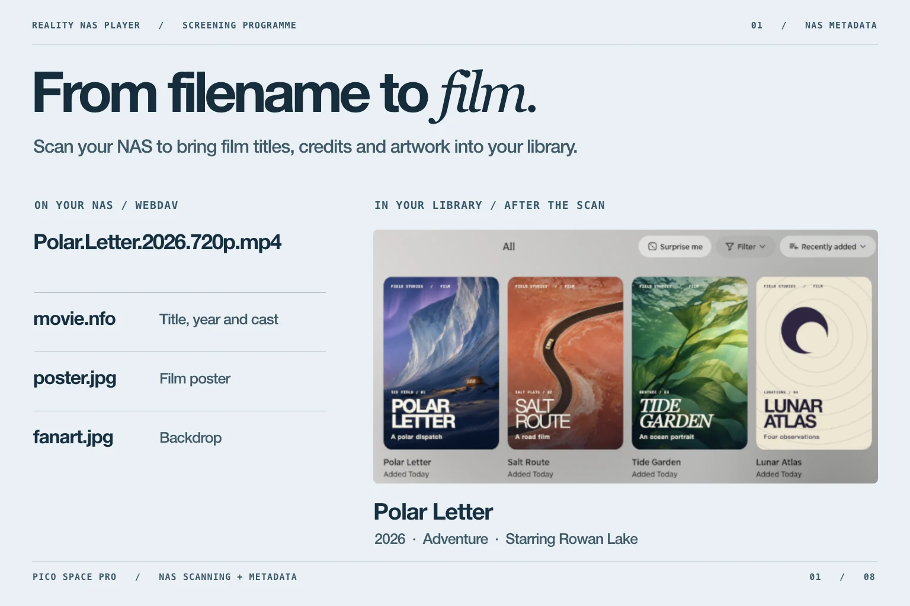

# Reality NAS Player

**PICO Space Pro のための、自分専用の映画館。**

**日本語** · [English](../../README.md) · [简体中文](zh-Hans.md) · [Español](es.md) · [Deutsch](de.md) · [Français](fr.md)

言語 (23)

**日本語** · [English](../../README.md) · [简体中文](zh-Hans.md) · [Español](es.md) · [Deutsch](de.md) · [Français](fr.md) · [Čeština](cs.md) · [Dansk](da.md) · [Ελληνικά](el.md) · [Suomi](fi.md) · [Italiano](it.md) · [한국어](ko.md) · [Bahasa Melayu](ms.md) · [Norsk bokmål](nb.md) · [Nederlands](nl.md) · [Polski](pl.md) · [Português (Brasil)](pt-BR.md) · [Română](ro.md) · [Русский](ru.md) · [Svenska](sv.md) · [ไทย](th.md) · [Türkçe](tr.md) · [繁體中文](zh-Hant.md)

[言語 (23) →](README.md)

NAS にしまってきた映画やドラマ、アニメのフォルダーをそのまま開けます。ファイル名だけではわからない作品も前後の手掛かりから探し、各話や映像特典を整理。**PICO Space Pro** のポスター棚で一本選んだら、地球を望む座席へどうぞ。

**[ヘッドセット用 APK](https://github.com/jason-jm/reality-nas-player/releases/download/v1.1.0/reality-nas-player-1.1.0-6.apk)** · [リリース情報とチェックサム](https://github.com/jason-jm/reality-nas-player/releases/tag/v1.1.0) · [デスクトップ版のビルド](../build.md)

## NAS のファイルから作品情報を自動取得

**手掛かりはフォルダーの中にも。** `Interstellar (2014)/video1.mkv` なら、親フォルダーから作品名と公開年がわかります。`Dark Staffel 2 Folge 3.mkv` のようにドイツ語で付けた名前もシーズン2の第3話として読み取れます。映画やドラマを探すときは原題や各国での公開タイトルも照合します。

**アニメの略称にも対応。** ある話の名前が `Seitokai` まででも、同じ場所の別の話に `Seitokai no Ichizon` とあれば、その正式名で AniList を検索できます。劇場版には個別のポスターを、ノンクレジットの OP・ED は本編の特典に。同じアニメ映画を映画棚とアニメ棚に置いた場合も、TMDB と AniList の原題と公開年を照らし合わせて、ひとつの作品から再生する版を選べます。

映画やドラマの Kodi NFO に TMDB ID があれば、オフラインでも中のあらすじや出演者を読み込み、手元のポスターや背景画像を使えます。映画はファイル名のタイトルと公開年から自動で照合し、ポスターやあらすじを取得します。アカウント登録も API キーの入力も不要です。シリーズの取り違えは作品単位で一度直せば、再スキャン後も修正が残ります。

[照合の具体例と、公開テストで確かめる方法を見る（英語）](../metadata-matching.md)

## ポスターをめくって次の一本を選ぶ

  

題名は忘れても、青い表紙なら覚えている。そんなときはポスターが並ぶライブラリへ。作品を開くと背景画像、あらすじ、出演者が見られ、ドラマならシーズンと話数を選べます。ジャンルや年代で絞り込んだり、前回の続きから再生したりできます。

## いま使っている保存先から再生

本体のファイルはシステムのファイル管理から開けます。PC の共有フォルダーには SMB、NAS には WebDAV、NFS、FTP、SFTP も利用できます。Jellyfin、Emby、Plex、DLNA にも対応。スマートフォンから送りたいときは DLNA 受信をオンにします。

## 今夜の上映場所を決める

宇宙を望むスペースラウンジには、中央と窓際を含む五つの席があります。プライベートシネマ、村の広場、砂漠のキャンプ場も選べます。座席は記憶され、一時停止すると照明が戻ります。周囲も見たいときはウィンドウ表示へ。

## カメラの後ろを振り返る

360° 動画は振り向いて、180°・VR180 動画は正面に広がる景色として楽しめます。ウィンドウ内ではドラッグで見回せます。左右分割・上下分割の 3D 映画は両眼に別々の映像を表示し、形式は手動でも選べます。

## 字幕も音声も好みの組み合わせで

内蔵・外部字幕のほか、ASS/SSA の装飾や PGS・VobSub の画像字幕に対応。吹き替えへの切り替えや音ずれの調整も可能です。MKV、MP4、旧形式の動画、暗号化されていない Blu-ray・DVD バックアップの本編を再生できます。ディスクメニューには非対応。4K・HDR の再生結果は機器とファイルによります。

## 旅の前にダウンロード

Wi-Fi を離れる前に本体に保存しておけば、移動中も再生できます。自分の SMB 共有を指定すれば、再生位置、お気に入り、手動で修正した作品情報をヘッドセット間で同期できます。広告や利用状況の解析はなく、オフラインでの作品判別も選べます。

## デスクでも同じライブラリ操作を

macOS・Windows ではマウスとキーボードで作品を探して再生できます。空間シネマはヘッドセット専用です。v1.1.0 はヘッドセット用 APK を配布しています。デスクトップ版はソースからビルドしてください。

## 最初の上映

PICO Space Pro に APK をサイドロードし、自分の動画を開くか共有フォルダーを追加します。再生コントロールから視聴空間を選んでください。画像は PICO OS 6 エミュレーターで撮影したもので、作例の映画は同梱されません。

[プライバシー](../privacy-policy.md) · [画像について](../showcase/README.md) · [MIT](../../LICENSE) · [言語 (23)](README.md)
