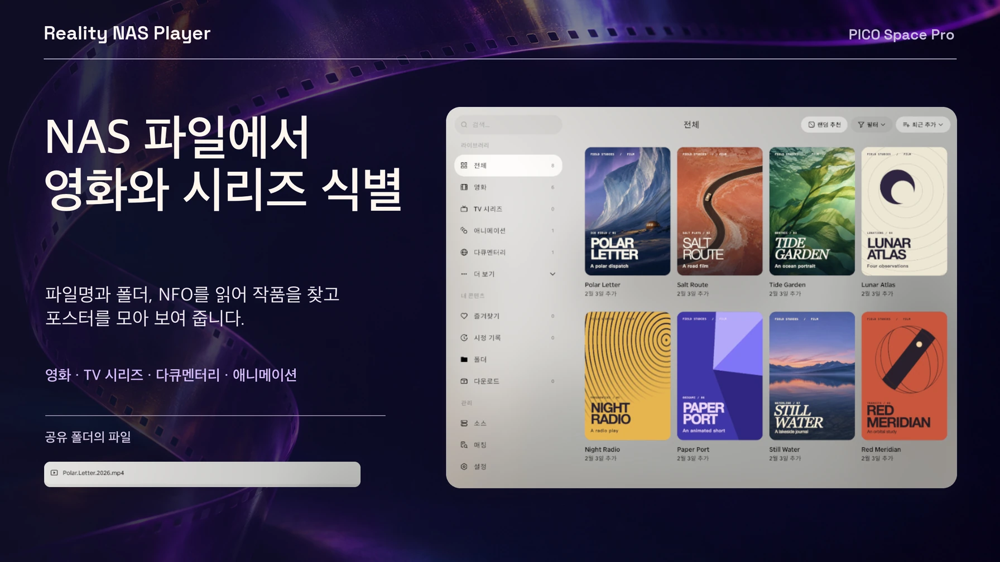
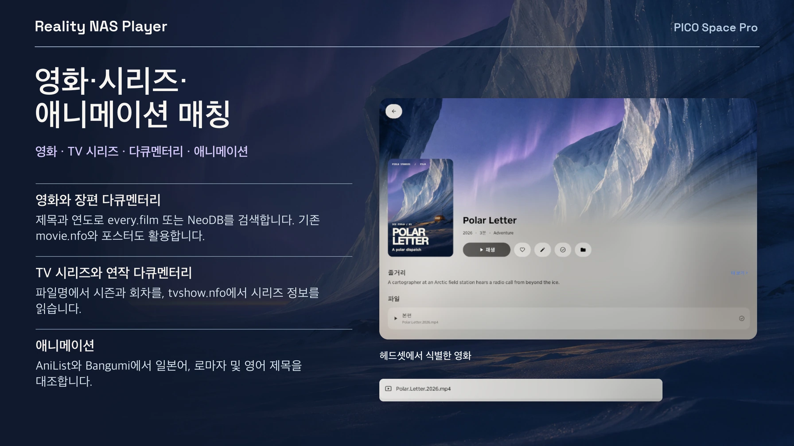
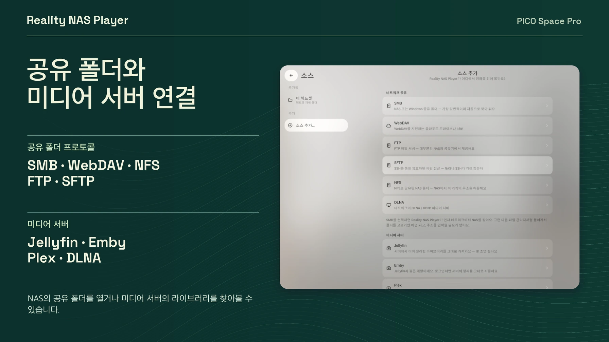
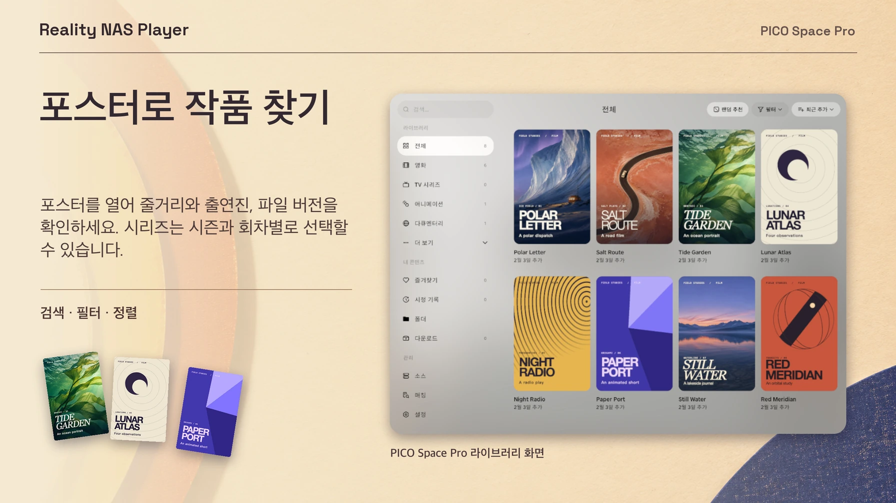
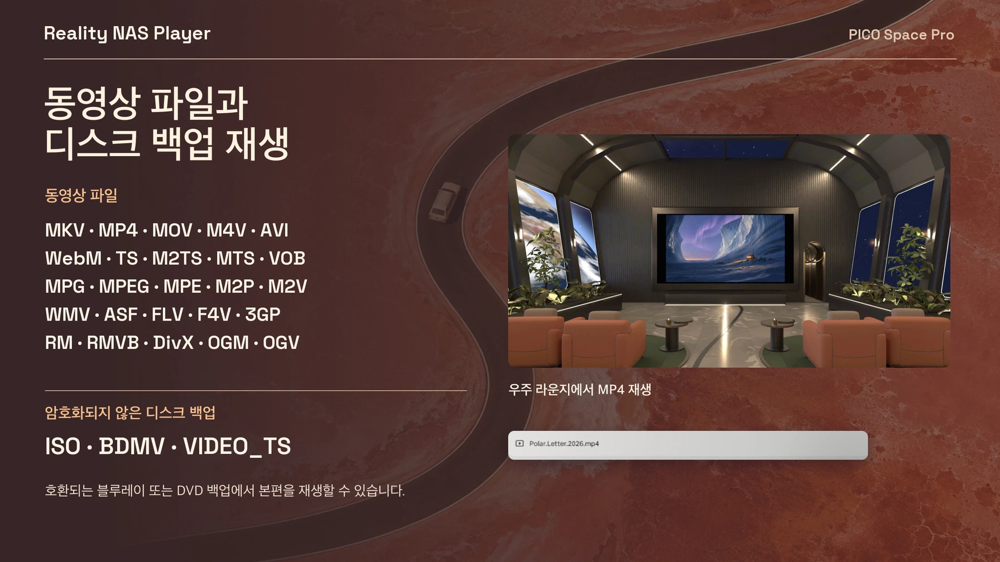
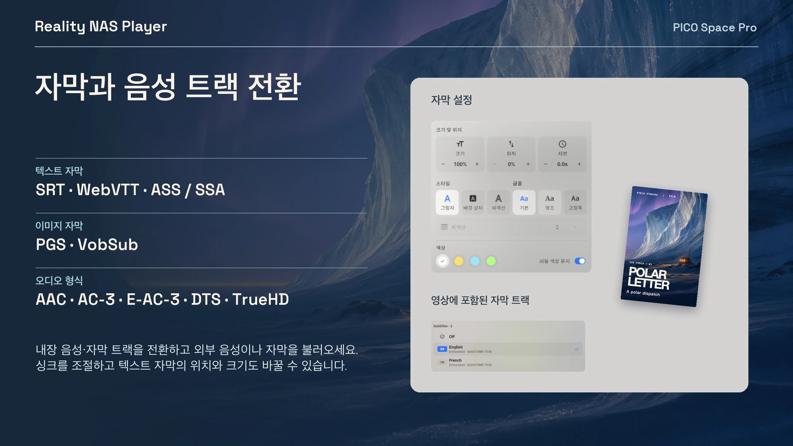
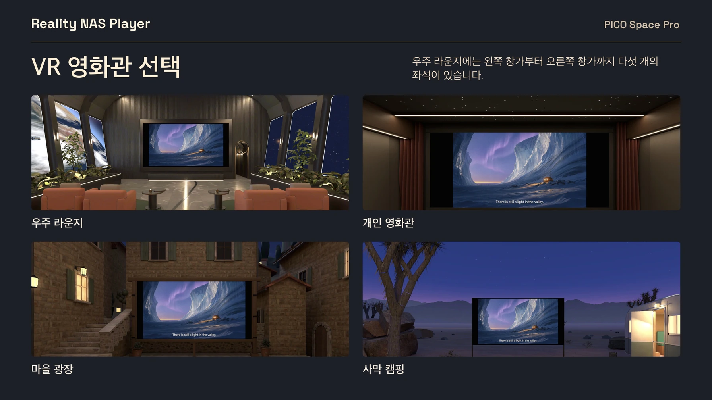
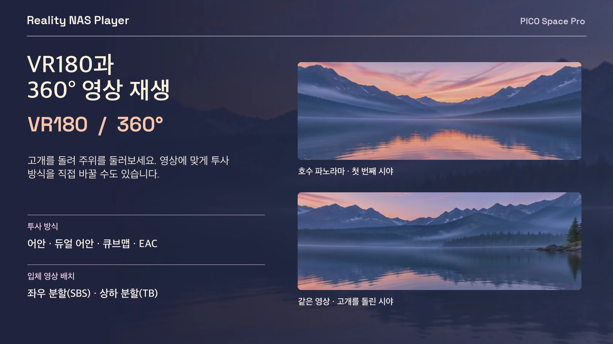

# Reality NAS Player

**PICO Space Pro**에서 영화, 드라마, 다큐멘터리, 애니메이션 정보를 찾고 포스터로 작품을 고르세요.

[English](../../README.md) · [简体中文](zh-Hans.md) · [繁體中文](zh-Hant.md) · [日本語](ja.md) · **한국어** · [Español](es.md) · [Deutsch](de.md) · [Français](fr.md) · [🌐 23](README.md)

[서명된 APK 다운로드 · v1.1.0](https://github.com/jason-jm/reality-nas-player/releases/download/v1.1.0/reality-nas-player-1.1.0-6.apk) · [공식 사이트](https://jason-jm.github.io/reality-nas-player/) · [▶ 0:31](https://jason-jm.github.io/reality-nas-player/?watch=1)

## 영화·드라마·다큐멘터리·애니메이션 식별

파일 이름이 video1.mkv여도 상위 폴더에서 제목과 연도를 읽을 수 있습니다. 영화와 단독 작품으로 나온 다큐멘터리는 every.film과 NeoDB에서 API 키 없이 찾습니다. 드라마와 시리즈 다큐멘터리는 시즌과 회차로 정리하고 기존 tvshow.nfo를 읽습니다. 애니메이션 제목은 AniList와 Bangumi로 확인합니다. Kodi 포스터와 직접 수정한 매칭도 유지됩니다.

## NAS 공유 폴더와 미디어 서버 연결

SMB, WebDAV, NFS, FTP, SFTP로 공유 폴더를 엽니다. 같은 네트워크의 DLNA 기기를 탐색하거나 Jellyfin, Emby, Plex 라이브러리에 연결할 수 있습니다.

## 포스터에서 작품과 회차 선택

포스터를 열어 줄거리, 출연진, 소장한 파일 버전을 확인하세요. 시리즈는 시즌별로 회차를 고를 수 있고, 영화는 지난번에 멈춘 곳에서 이어볼 수 있습니다.

## 영상 형식과 자막·음성 트랙

읽을 수 있는 영상 파일은 MKV, MP4, M4V, MOV, AVI, WebM, TS, M2TS, MTS, MPG, MPEG, MPE, M2P, M2V, VOB, WMV, ASF, RM, RMVB, FLV, F4V, OGM, OGV, DivX, 3GP입니다. 호환되는 비암호화 블루레이와 DVD 백업(ISO, BDMV, VIDEO_TS)에서 본편을 재생합니다. 자막은 SRT, WebVTT, ASS/SSA, PGS, VobSub를 지원합니다. 자막이나 음성 트랙을 바꾸고 글자 크기와 표시 시간을 조절하거나 외부 더빙을 추가하세요. DTS와 TrueHD 음성도 지원합니다.

## 네 가지 VR 상영관

우주 라운지에는 양쪽 창가를 포함해 다섯 좌석이 있습니다. 개인 영화관, 마을 광장, 사막 캠핑에서도 공간 안의 스크린으로 영화를 볼 수 있습니다.

## VR180 및 360° 영상 재생

고개를 돌려 주변을 둘러보세요. 좌우·상하 분할 입체 영상, 어안 영상과 큐브맵을 지원합니다. 파일에 있는 투사 정보를 읽으며 사용자가 직접 투사 방식과 입체 배열을 바꿀 수도 있습니다.

[서명된 APK 다운로드 · v1.1.0](https://github.com/jason-jm/reality-nas-player/releases/download/v1.1.0/reality-nas-player-1.1.0-6.apk) · [GitHub Releases](https://github.com/jason-jm/reality-nas-player/releases) · [MIT](https://github.com/jason-jm/reality-nas-player/blob/main/LICENSE) · [🌐 23](README.md)
