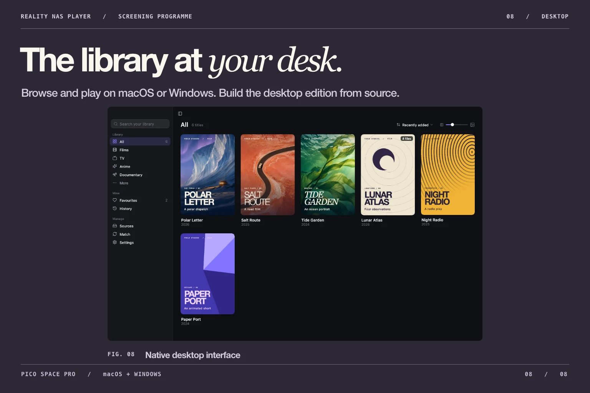

# Reality NAS Player

**Pawagam peribadi yang dibina untuk PICO Space Pro.**

**Bahasa Melayu** · [English](../../README.md) · [简体中文](zh-Hans.md) · [日本語](ja.md) · [Español](es.md) · [Deutsch](de.md) · [Français](fr.md)

Bahasa (23)

**Bahasa Melayu** · [English](../../README.md) · [简体中文](zh-Hans.md) · [日本語](ja.md) · [Español](es.md) · [Deutsch](de.md) · [Français](fr.md) · [Čeština](cs.md) · [Dansk](da.md) · [Ελληνικά](el.md) · [Suomi](fi.md) · [Italiano](it.md) · [한국어](ko.md) · [Norsk bokmål](nb.md) · [Nederlands](nl.md) · [Polski](pl.md) · [Português (Brasil)](pt-BR.md) · [Română](ro.md) · [Русский](ru.md) · [Svenska](sv.md) · [ไทย](th.md) · [Türkçe](tr.md) · [繁體中文](zh-Hant.md)

[Bahasa (23) →](README.md)

Sambungkan folder filem dan siri pada NAS anda ke PICO Space Pro. Reality NAS Player mengenal pasti tajuk dan menyusun koleksi anda. Pilih filem melalui poster, kemudian duduk dan tonton dengan pemandangan Bumi.

**[Muat turun APK set kepala](https://github.com/jason-jm/reality-nas-player/releases/download/v1.0/reality-nas-player-1.0-4.apk)** · [Nota keluaran dan nilai semak](https://github.com/jason-jm/reality-nas-player/releases/tag/v1.0) · [Bina aplikasi komputer](../build.md)

## Daripada folder NAS kepada maklumat filem

Tambah folder kongsi dan mulakan imbasan. Pemain mengenal pasti filem dan episod melalui nama fail, tahun serta nombor musim dan episod. Ia turut membaca ID filem atau siri dalam fail NFO Kodi dan menggunakan poster serta latar yang disimpan bersama video. Sinopsis dan barisan pelakon Polar Letter dalam gambar dibaca daripada NFO melalui WebDAV tanpa carian dalam talian. Untuk carian TMDB, tambah kunci API anda sendiri. Padanan yang salah boleh dibetulkan.

## Selak koleksi mengikut poster

Ingat poster biru tetapi terlupa tajuknya? Pilih kulit filem untuk melihat latar, sinopsis dan pelakon. Untuk siri, pilih musim dan episod. Tapis mengikut genre atau dekad, atau sambung menonton dari babak terakhir.

## Terus dari tempat anda menyimpan filem

Buka fail pada peranti atau sambungkan folder kongsi melalui SMB, WebDAV, NFS, FTP atau SFTP. Jika anda sudah menggunakan Jellyfin, Emby, Plex atau DLNA, koleksi anda boleh kekal di pelayan tersebut.

## Pilih tempat duduk untuk malam ini

Ruang istirahat angkasa menawarkan lima tempat duduk dengan pemandangan Bumi. Cuba juga pawagam persendirian, dataran kampung atau perkhemahan padang pasir. Lampu menyala apabila tayangan dijeda. Anda boleh kembali ke tetingkap terapung semasa menonton.

## Pandang ke seberang tasik

Pusingkan kepala dalam video 360° untuk melihat apa yang ada di belakang. Video 180° dan VR180 terbentang di hadapan. Untuk filem 3D dengan imej bersebelahan atau bertindih atas dan bawah, setiap mata menerima pandangannya sendiri.

## Sari kata dan suara pilihan anda

Pilih audio asal atau alih suara, laraskan kelewatan audio dan muatkan sari kata luar. ASS/SSA, PGS dan VobSub disokong. Anda juga boleh memainkan filem utama daripada salinan Blu-ray atau DVD yang tidak disulitkan, tanpa menu cakera.

## Bawa filem dalam perjalanan

Muat turun sebelum meninggalkan Wi-Fi. Di rumah, folder SMB pilihan anda boleh menyegerakkan kemajuan tontonan, kegemaran dan pembetulan tajuk antara peranti. Penyegerakan ini pilihan anda. Tiada iklan atau analitik penggunaan.

## Tonton di meja juga

Pada macOS dan Windows, gunakan tetikus dan papan kekunci untuk melayari koleksi dan memainkan filem. Pawagam ruang maya dikhususkan untuk set kepala. v1.0 menyediakan APK bertandatangan; aplikasi komputer dibina daripada kod sumber.

## Tayangan pertama

Pasang APK pada PICO Space Pro, buka video sendiri dan pilih ruang tontonan melalui kawalan pemain. Paparan set kepala dirakam dalam emulator PICO OS 6. Filem demonstrasi tidak disertakan.

[Privasi](../privacy-policy.md) · [Tentang imej](../showcase/README.md) · [MIT](../../LICENSE) · [Bahasa (23)](README.md)
