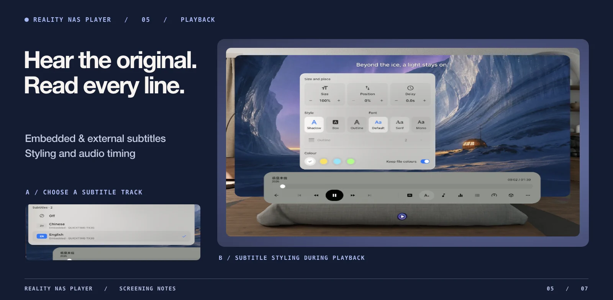

# Reality NAS Player

**Din egen kino, laget for PICO Space Pro.**

**Norsk bokmål** · [English](../../README.md) · [简体中文](zh-Hans.md) · [日本語](ja.md) · [Español](es.md) · [Deutsch](de.md) · [Français](fr.md)

Språk (23)

**Norsk bokmål** · [English](../../README.md) · [简体中文](zh-Hans.md) · [日本語](ja.md) · [Español](es.md) · [Deutsch](de.md) · [Français](fr.md) · [Čeština](cs.md) · [Dansk](da.md) · [Ελληνικά](el.md) · [Suomi](fi.md) · [Italiano](it.md) · [한국어](ko.md) · [Bahasa Melayu](ms.md) · [Nederlands](nl.md) · [Polski](pl.md) · [Português (Brasil)](pt-BR.md) · [Română](ro.md) · [Русский](ru.md) · [Svenska](sv.md) · [ไทย](th.md) · [Türkçe](tr.md) · [繁體中文](zh-Hant.md)

[Språk (23) →](README.md)

**[Se filmen på 31 sekunder](https://jason-jm.github.io/reality-nas-player/?watch=1)** · [Offisielt nettsted](https://jason-jm.github.io/reality-nas-player/)

Åpne mappene med film, serier og anime som du har samlet på NAS-en din. Reality NAS Player kjenner igjen titlene, setter episodene i rekkefølge og legger ekstramaterialet ved riktig serie. Velg et omslag på **PICO Space Pro**, og finn deg en plass med utsikt mot jorda.

**[Last ned APK til headset](https://github.com/jason-jm/reality-nas-player/releases/download/v1.1.0/reality-nas-player-1.1.0-6.apk)** · [Versjonsnotater og kontrollsummer](https://github.com/jason-jm/reality-nas-player/releases/tag/v1.1.0) · [Bygg datamaskinappen](../build.md)

## Fra NAS-mapper til filmopplysninger

**Mappenavnet gir også ledetråder.** I `Interstellar (2014)/video1.mkv` oppgir mappen både tittel og årstall. En fil som heter `Dark Staffel 2 Folge 3.mkv` havner som tredje episode i andre sesong. Spilleren kan også søke etter originaltitler og titler brukt i andre land.

Hvis en animeepisode bare heter `Seitokai`, kan en annen episode i samme mappe gi hele navnet til søket på AniList. En kinofilm kan få sitt eget omslag, mens åpnings- og avslutningssekvenser uten tekst legges under ekstramaterialet til serien. To kopier av samme film kan dele kort, slik at du kan velge hvilken du vil spille.

Med en Kodi-NFO som har en TMDB-ID, kan spilleren hente handlingsreferat og rolleliste for filmer og serier lokalt og bruke dine egne omslag og bakgrunner. Under skanningen gjenkjenner spilleren filmer ut fra tittel og år og henter tilgjengelige plakater og handlingsreferater, uten konto eller API-nøkkel. Du kan rette en feil kobling for hele seriekortet på én gang. Valget står også etter neste skanning.

[Se eksemplene og prøv prosjektets tester (på engelsk)](../metadata-matching.md)

## Bla i omslagene

  

Husker du den blå plakaten bedre enn tittelen? Finn den på plakatveggen og åpne filmen for å se bakgrunnsbilde, handling og medvirkende. I en serie velger du sesong og episode. Filtrer etter sjanger eller tiår, eller fortsett der du slapp.

## Bruk lagringen du har

Åpne en lokal fil eller en delt mappe på datamaskinen via SMB. WebDAV, NFS, FTP og SFTP støttes, i tillegg til Jellyfin, Emby, Plex og DLNA. Slå på DLNA-mottak for å sende video fra en kompatibel mobil.

## Hvor vil du sitte?

Romloungen har fem plasser. Du kan også velge privatkinoen, landsbytorget eller leiren i ørkenen. Rommet husker setet, og lyset kommer tilbake når du tar pause. Du kan bytte til et svevende vindu.

## Se hva som er bak deg

Snu deg i en 360°-film, eller utforsk motivet foran deg i 180° og VR180. I et vindu kan du dra for å se deg rundt. I 3D-filmer med bilder side om side eller over hverandre får hvert øye sitt eget bilde.

## Velg lyd og tekst

Bytt til et eksternt dubbespor, juster lydforsinkelsen og bruk teksting i ASS/SSA, PGS eller VobSub. Spilleren støtter MKV, MP4, eldre formater og hovedfilmen fra ukrypterte Blu-ray- og DVD-kopier, uten platemenyer. 4K og HDR avhenger av fil og enhet.

## En film til reisen

Last ned før du forlater trådløsnettet. Du kan bruke din egen SMB-deling til å synkronisere fremdrift, favoritter og manuelle tittelkoblinger mellom headset. Ingen reklame eller bruksanalyse; frakoblet gjenkjenning bruker lokale opplysninger.

## Ved skrivebordet

På macOS og Windows kan du bla og spille av med mus og tastatur. De virtuelle kinoene er for headsettet. v1.1.0 tilbyr en APK til headsettet; datamaskinappen må bygges fra kildekoden.

## Første visning

Installer APK-filen på PICO Space Pro, åpne en egen video eller legg til en delt mappe, og velg visningsrom i spilleren. Headsetbildene er tatt i PICO OS 6-emulatoren. Eksempelfilmene følger ikke med.

[Personvern](../privacy-policy.md) · [Om bildene](../showcase/README.md) · [MIT](../../LICENSE) · [Språk (23)](README.md)
