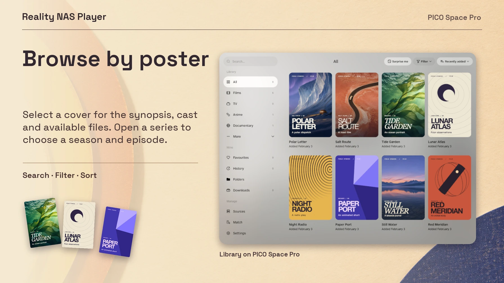

# Reality NAS Player

Herken films, orden afleveringen en speel NAS-video’s af op **PICO Space Pro**.

[English](../../README.md) · [简体中文](zh-Hans.md) · [繁體中文](zh-Hant.md) · [日本語](ja.md) · [한국어](ko.md) · [Español](es.md) · [Deutsch](de.md) · [Français](fr.md) · [🌐 23](README.md)

[Ondertekende APK downloaden · v1.2.0](https://github.com/jason-jm/reality-nas-player/releases/download/v1.2.0/reality-nas-player-1.2.0-8.apk) · [Web](https://jason-jm.github.io/reality-nas-player/) · [▶ 0:31](https://jason-jm.github.io/reality-nas-player/?watch=1)

## Films, series, documentaires en anime herkennen

Ook bij video1.mkv kan de map de filmtitel en het jaar geven. De speler zoekt films en losse documentaires zonder API-sleutel op bij every.film en NeoDB. Voor series en documentairereeksen leest hij seizoen, aflevering en bestaande tvshow.nfo-bestanden. Anime wordt gekoppeld via AniList en Bangumi. Je Kodi-posters en handmatige correcties blijven behouden.

## Verbinding maken met je NAS

Open gedeelde mappen via SMB, WebDAV, NFS, FTP of SFTP. Blader door DLNA-apparaten op je netwerk of verbind een bibliotheek van Jellyfin, Emby of Plex.

## Kiezen op de posterwand

Open een poster voor het verhaal, de cast en de versies die je hebt. Kies bij een serie een seizoen en aflevering, of kijk een film verder vanaf het laatste kijkmoment.

## Bestanden, ondertiteling en geluid

Herkenbare videobestanden zijn onder meer MKV, MP4, M4V, MOV, AVI, WebM, TS, M2TS, MTS, MPG, MPEG, MPE, M2P, M2V, VOB, WMV, ASF, RM, RMVB, FLV, F4V, OGM, OGV, DivX, 3GP. Speel de hoofdfilm van een compatibele, onversleutelde Blu-ray- of dvd-kopie (ISO, BDMV, VIDEO_TS). Ondertitels omvatten SRT, WebVTT, ASS/SSA, PGS, VobSub. Wissel van spoor, pas tekstgrootte en timing aan of voeg een externe nasynchronisatie toe. DTS en TrueHD worden ondersteund.

## Vier VR-bioscopen

De ruimtelounge heeft vijf zitplaatsen, waarvan twee bij het raam. Kijk ook op het scherm in de privébioscoop, op het dorpsplein of in het woestijnkamp.

## VR180 en 360° afspelen

Kijk om je heen door je hoofd te draaien. Kies stereo naast of boven elkaar, fisheye of kubusprojectie. De speler leest de projectie uit het bestand en laat je die zelf wijzigen.

[Ondertekende APK downloaden · v1.2.0](https://github.com/jason-jm/reality-nas-player/releases/download/v1.2.0/reality-nas-player-1.2.0-8.apk) · [GitHub Releases](https://github.com/jason-jm/reality-nas-player/releases) · [MIT](https://github.com/jason-jm/reality-nas-player/blob/main/LICENSE) · [🌐 23](README.md)
