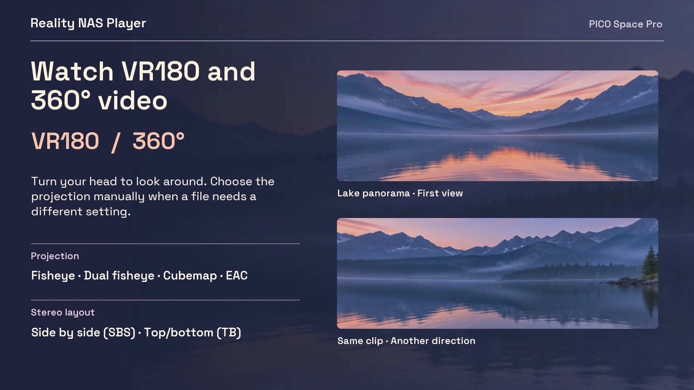

# Reality NAS Player

Identifique filmes, organize episódios e assista ao seu NAS no **PICO Space Pro**.

[English](../../README.md) · [简体中文](zh-Hans.md) · [繁體中文](zh-Hant.md) · [日本語](ja.md) · [한국어](ko.md) · [Español](es.md) · [Deutsch](de.md) · [Français](fr.md) · [🌐 23](README.md)

[Baixar o APK assinado · v1.1.0](https://github.com/jason-jm/reality-nas-player/releases/download/v1.1.0/reality-nas-player-1.1.0-6.apk) · [Web](https://jason-jm.github.io/reality-nas-player/) · [▶ 0:31](https://jason-jm.github.io/reality-nas-player/?watch=1)

## Identifique filmes, séries, documentários e animes

Mesmo quando o arquivo se chama video1.mkv, a pasta pode informar o título e o ano. Para filmes e documentários avulsos, o app consulta every.film e NeoDB sem chave de API. Para séries de ficção ou documentais, lê temporada, episódio e o arquivo tvshow.nfo, quando disponível. AniList e Bangumi ajudam a identificar animes. Os pôsteres do Kodi e os ajustes manuais são preservados.

## Conecte pastas e servidores de mídia

Acesse o NAS por SMB, WebDAV, NFS, FTP ou SFTP. Explore dispositivos DLNA na rede ou conecte sua biblioteca do Jellyfin, Emby ou Plex.

## Escolha pelo mural de pôsteres

Abra um pôster para consultar sinopse, elenco e as versões do filme que você tem. Escolha temporada e episódio de uma série ou retome o filme de onde parou.

## Formatos de vídeo, legendas e áudio

Arquivos reconhecidos incluem MKV, MP4, M4V, MOV, AVI, WebM, TS, M2TS, MTS, MPG, MPEG, MPE, M2P, M2V, VOB, WMV, ASF, RM, RMVB, FLV, F4V, OGM, OGV, DivX, 3GP. Reproduza o filme principal de cópias compatíveis de Blu-ray ou DVD sem criptografia (ISO, BDMV, VIDEO_TS). Legendas incluem SRT, WebVTT, ASS/SSA, PGS, VobSub. Troque a faixa, ajuste tamanho do texto e sincronia ou adicione uma dublagem externa. Há suporte a áudio DTS e TrueHD.

## Quatro salas em RV

O salão espacial tem cinco lugares, dois junto às janelas. Você também pode assistir no cinema privado, na praça da vila ou no acampamento no deserto.

## Vídeo VR180 e em 360°

Vire a cabeça para explorar a cena. Use estéreo lado a lado ou de cima para baixo, olho de peixe ou mapa de cubo. A projeção pode seguir os dados do arquivo ou ser ajustada manualmente.

[Baixar o APK assinado · v1.1.0](https://github.com/jason-jm/reality-nas-player/releases/download/v1.1.0/reality-nas-player-1.1.0-6.apk) · [GitHub Releases](https://github.com/jason-jm/reality-nas-player/releases) · [MIT](https://github.com/jason-jm/reality-nas-player/blob/main/LICENSE) · [🌐 23](README.md)
