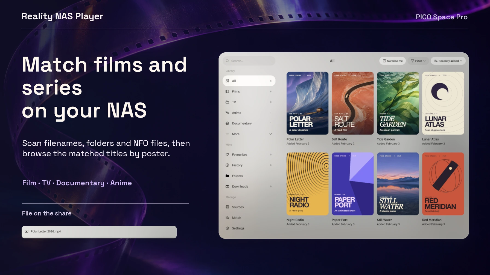
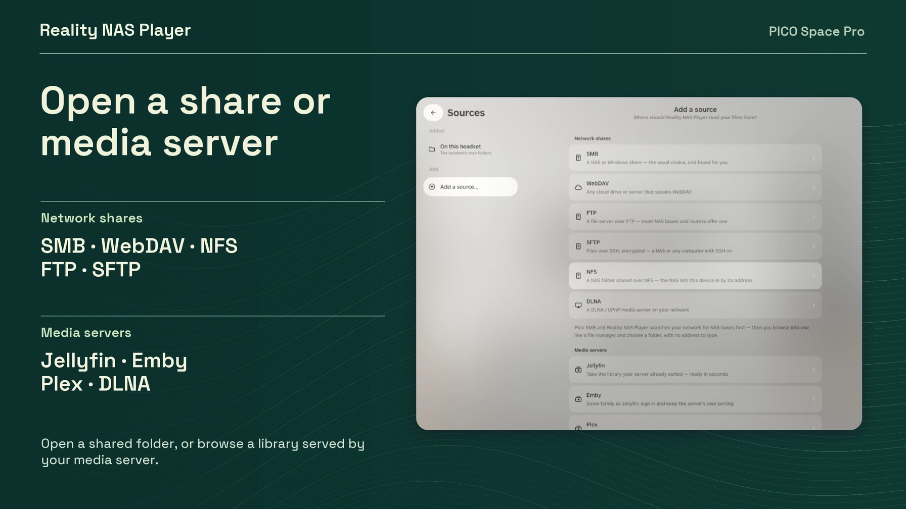

# Reality NAS Player

Identifică filme, ordonează episoade și redă video de pe NAS pe **PICO Space Pro**.

[English](../../README.md) · [简体中文](zh-Hans.md) · [繁體中文](zh-Hant.md) · [日本語](ja.md) · [한국어](ko.md) · [Español](es.md) · [Deutsch](de.md) · [Français](fr.md) · [🌐 23](README.md)

[Descarcă APK-ul semnat · v1.2.0](https://github.com/jason-jm/reality-nas-player/releases/download/v1.2.0/reality-nas-player-1.2.0-8.apk) · [Web](https://jason-jm.github.io/reality-nas-player/) · [▶ 0:31](https://jason-jm.github.io/reality-nas-player/?watch=1)

## Identifică filme, seriale, documentare și anime

Chiar și pentru video1.mkv, dosarul poate indica titlul și anul. Filmele și documentarele de sine stătătoare sunt căutate în every.film și NeoDB fără cheie API. Pentru seriale și serii documentare, aplicația citește sezonul, episodul și fișierele tvshow.nfo existente. Anime-urile sunt identificate cu AniList și Bangumi. Afișele Kodi și corecturile tale se păstrează.

## Conectează NAS-ul și serverele media

Deschide dosare partajate prin SMB, WebDAV, NFS, FTP sau SFTP. Răsfoiește dispozitivele DLNA din rețea sau conectează o bibliotecă Jellyfin, Emby ori Plex.

## Alege de pe peretele cu afișe

Deschide un afiș pentru rezumat, distribuție și versiunile pe care le ai. Alege sezonul și episodul unui serial sau continuă un film din locul în care te-ai oprit.

## Formate video, subtitrări și piste audio

Fișierele video recunoscute includ MKV, MP4, M4V, MOV, AVI, WebM, TS, M2TS, MTS, MPG, MPEG, MPE, M2P, M2V, VOB, WMV, ASF, RM, RMVB, FLV, F4V, OGM, OGV, DivX, 3GP. Redă filmul principal din copii Blu-ray sau DVD compatibile și necriptate (ISO, BDMV, VIDEO_TS). Formatele de subtitrare includ SRT, WebVTT, ASS/SSA, PGS, VobSub. Schimbă pista, ajustează mărimea textului și sincronizarea sau adaugă un dublaj extern. Sunt acceptate DTS și TrueHD.

## Patru săli de cinema VR

Salonul spațial are cinci locuri, dintre care două lângă ferestre. Poți vedea filmul și în cinematograful privat, în piața satului sau în tabăra din deșert.

## Redare VR180 și la 360°

Întoarce capul pentru a privi în jur. Sunt disponibile stereo stânga-dreapta sau sus-jos, proiecție fisheye și hartă cubică. Proiecția poate fi citită din fișier sau aleasă manual.

[Descarcă APK-ul semnat · v1.2.0](https://github.com/jason-jm/reality-nas-player/releases/download/v1.2.0/reality-nas-player-1.2.0-8.apk) · [GitHub Releases](https://github.com/jason-jm/reality-nas-player/releases) · [MIT](https://github.com/jason-jm/reality-nas-player/blob/main/LICENSE) · [🌐 23](README.md)
