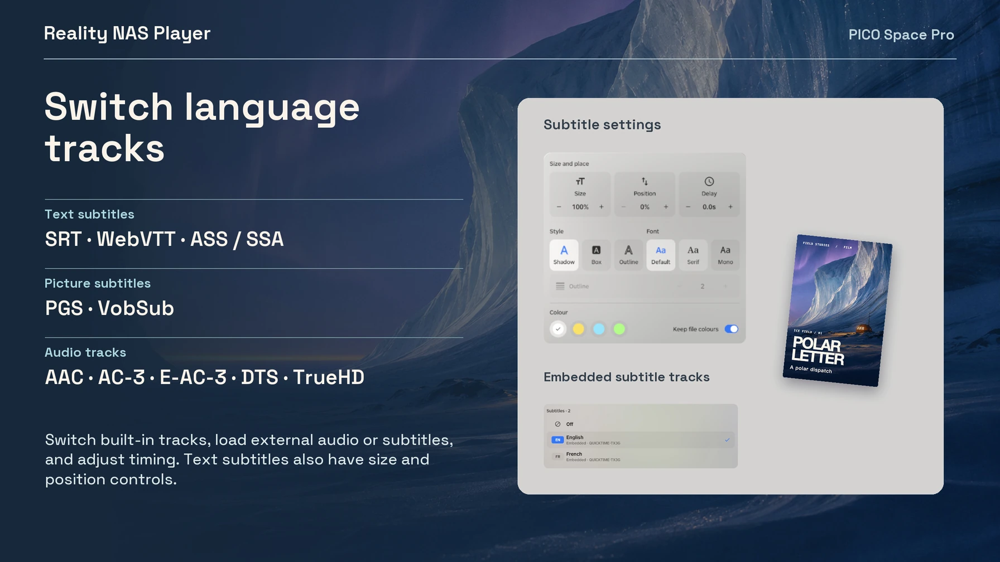

# Reality NAS Player

ค้นข้อมูลหนัง จัดตอนตามซีซัน และเล่นวิดีโอจาก NAS บน **PICO Space Pro**

[English](../../README.md) · [简体中文](zh-Hans.md) · [繁體中文](zh-Hant.md) · [日本語](ja.md) · [한국어](ko.md) · [Español](es.md) · [Deutsch](de.md) · [Français](fr.md) · [🌐 23](README.md)

[ดาวน์โหลด APK ที่ลงนามแล้ว · v1.2.0](https://github.com/jason-jm/reality-nas-player/releases/download/v1.2.0/reality-nas-player-1.2.0-8.apk) · [Web](https://jason-jm.github.io/reality-nas-player/) · [▶ 0:31](https://jason-jm.github.io/reality-nas-player/?watch=1)

## ค้นข้อมูลภาพยนตร์ ซีรีส์ สารคดี และอนิเมะ

แม้ไฟล์จะชื่อ video1.mkv แอปก็อ่านชื่อเรื่องและปีจากโฟลเดอร์ได้ ภาพยนตร์และสารคดีจบในเรื่องค้นผ่าน every.film และ NeoDB ได้โดยไม่ต้องมีคีย์ API ส่วนซีรีส์และสารคดีหลายตอนจะจัดตามซีซันและตอน พร้อมอ่านไฟล์ tvshow.nfo ที่มีอยู่ แอประบุชื่ออนิเมะด้วย AniList และ Bangumi และเก็บโปสเตอร์จาก Kodi รวมถึงรายการที่คุณแก้ไขเอง

## เชื่อมต่อ NAS และเซิร์ฟเวอร์สื่อ

เปิดโฟลเดอร์ที่แชร์ผ่าน SMB, WebDAV, NFS, FTP หรือ SFTP เลือกดูอุปกรณ์ DLNA ในเครือข่าย หรือเชื่อมคลัง Jellyfin, Emby หรือ Plex

## เลือกเรื่องจากผนังโปสเตอร์

เปิดโปสเตอร์เพื่อดูเรื่องย่อ นักแสดง และไฟล์แต่ละเวอร์ชันที่คุณมี เลือกซีซันและตอนของซีรีส์ หรือดูหนังต่อจากจุดที่หยุดไว้

## รูปแบบไฟล์ คำบรรยาย และเสียง

ไฟล์วิดีโอที่อ่านได้มี MKV, MP4, M4V, MOV, AVI, WebM, TS, M2TS, MTS, MPG, MPEG, MPE, M2P, M2V, VOB, WMV, ASF, RM, RMVB, FLV, F4V, OGM, OGV, DivX, 3GP เล่นหนังเรื่องหลักจากสำเนา Blu-ray หรือ DVD ที่รองรับและไม่เข้ารหัส (ISO, BDMV, VIDEO_TS) รองรับคำบรรยาย SRT, WebVTT, ASS/SSA, PGS, VobSub เปลี่ยนแทร็ก ปรับขนาดและเวลาของข้อความ หรือเพิ่มเสียงพากย์จากไฟล์ภายนอกได้ รวมทั้งรองรับเสียง DTS และ TrueHD

## โรงภาพยนตร์ VR สี่แห่ง

เลานจ์อวกาศมีห้าที่นั่ง รวมที่นั่งริมหน้าต่างสองที่ ยังเลือกชมบนจอในโรงภาพยนตร์ส่วนตัว ลานหมู่บ้าน หรือแคมป์กลางทะเลทรายได้

## เล่นวิดีโอ VR180 และ 360°

หันศีรษะเพื่อมองรอบตัว รองรับภาพสเตอริโอแบบซ้ายขวาและบนล่าง รวมถึงภาพฟิชอายและคิวบ์แมป แอปอ่านรูปแบบการฉายจากไฟล์ และคุณเลือกเปลี่ยนเองได้

[ดาวน์โหลด APK ที่ลงนามแล้ว · v1.2.0](https://github.com/jason-jm/reality-nas-player/releases/download/v1.2.0/reality-nas-player-1.2.0-8.apk) · [GitHub Releases](https://github.com/jason-jm/reality-nas-player/releases) · [MIT](https://github.com/jason-jm/reality-nas-player/blob/main/LICENSE) · [🌐 23](README.md)
