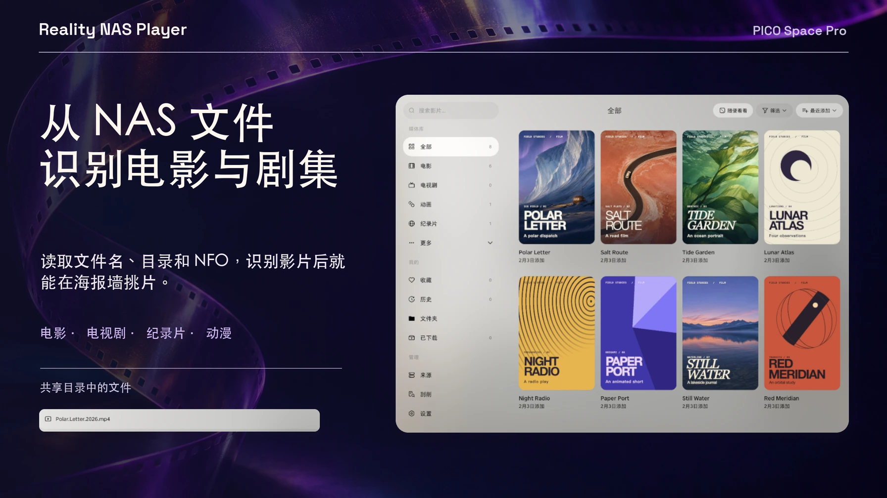
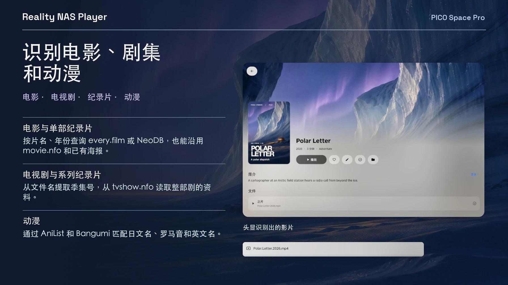
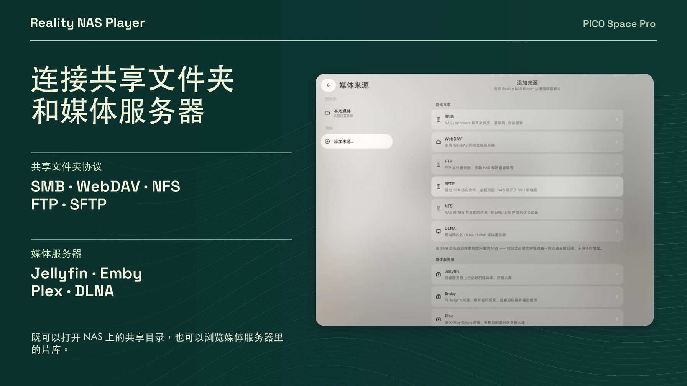
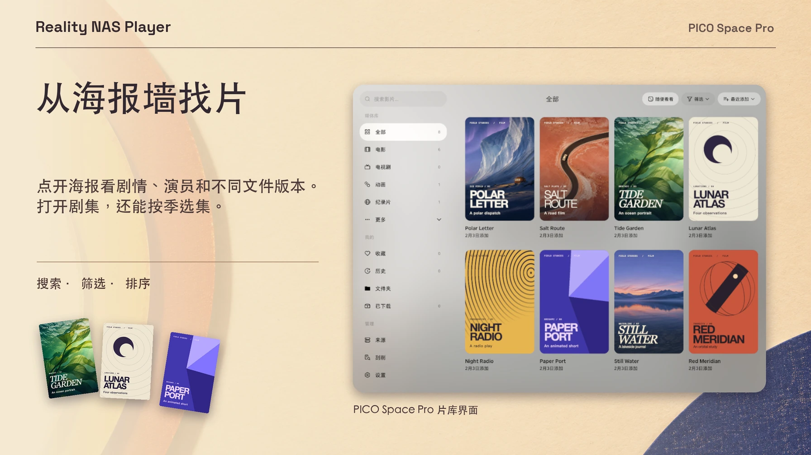
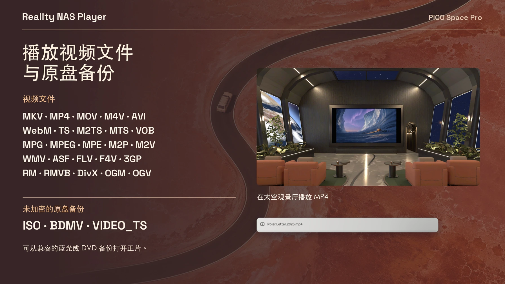
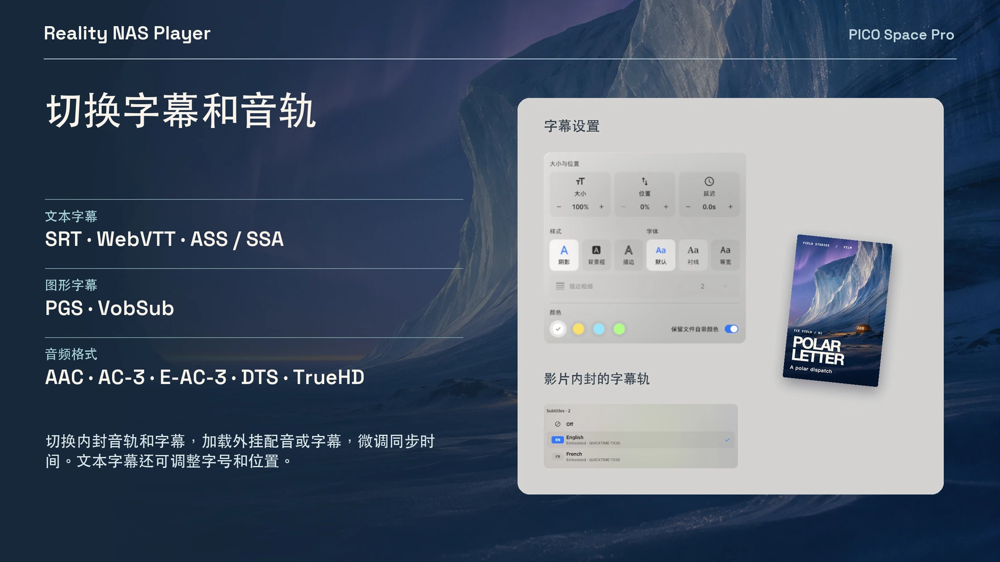
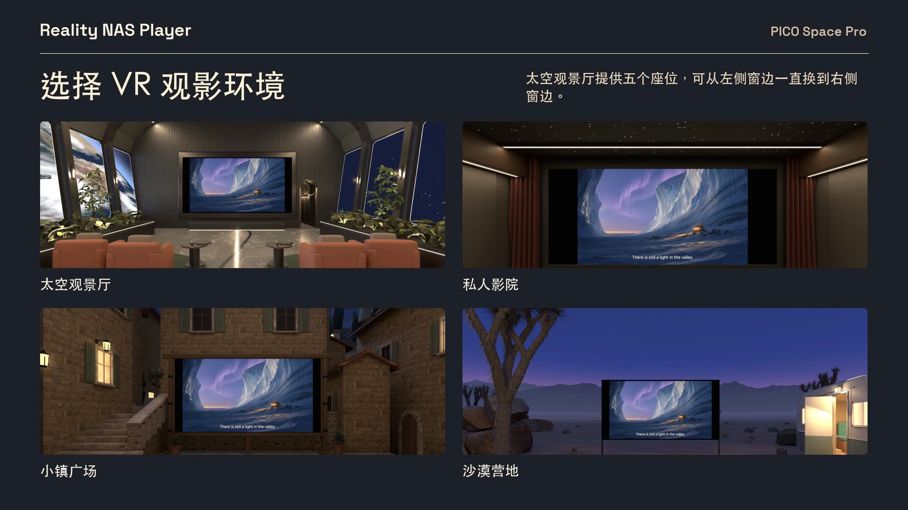
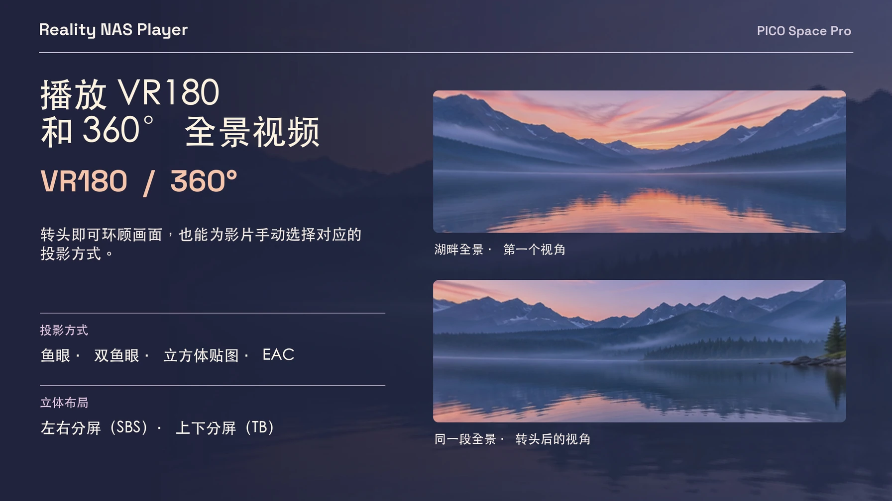

# Reality NAS Player

为 **PICO Space Pro** 打造。刮削电影、剧集、纪录片和动漫，从海报墙选片播放。

[English](../../README.md) · **简体中文** · [繁體中文](zh-Hant.md) · [日本語](ja.md) · [한국어](ko.md) · [Español](es.md) · [Deutsch](de.md) · [Français](fr.md) · [🌐 23](README.md)

[下载正式签名 APK · v1.2.0](https://github.com/jason-jm/reality-nas-player/releases/download/v1.2.0/reality-nas-player-1.2.0-8.apk) · [官网](https://jason-jm.github.io/reality-nas-player/zh.html) · [▶ 0:31](https://jason-jm.github.io/reality-nas-player/zh.html?watch=1)

## 电影、电视剧、纪录片和动漫怎么刮削

文件只叫 video1.mkv，也可以从上一级目录提取片名和年份。电影和单部纪录片可用 every.film、NeoDB 联网匹配，无需申请密钥。电视剧和系列纪录片按季、集归档，并读取已有的 tvshow.nfo。动漫通过 AniList 和 Bangumi 核对片名。已有的 Kodi 海报可以沿用，手动纠正的匹配会保留到下次扫描。

在已公开的 NAS 电影测试中，**267 部电影认对 266 部**，每部都取得海报。另有 1 部保留待识别，错配为 0 部。[电影测试与评分口径](https://github.com/jason-jm/reality-nas-player/blob/v1.1.0/docs/keyless-verification.md)

电视剧和系列纪录片可通过 TVmaze 等公开资料库免密钥匹配，动漫支持离线匹配多语片名。WebDAV 可扫描更大的片库，并读取文件大小以选择原盘正片。 [1.2.0](https://github.com/jason-jm/reality-nas-player/releases/tag/v1.2.0)

## 连接 NAS 共享目录和媒体服务器

共享文件夹支持 SMB、WebDAV、NFS、FTP 和 SFTP。也可以浏览局域网中的 DLNA 设备，或直接连接 Jellyfin、Emby、Plex 媒体库。

## 从海报墙挑片、选集、续播

点一张海报就能看剧情、演员和自己收藏的不同文件版本。剧集按季排列，展开即可选集。没看完的电影可以从上次停下的位置继续。

## 视频格式、字幕和音轨

可扫描的视频文件包括 MKV, MP4, M4V, MOV, AVI, WebM, TS, M2TS, MTS, MPG, MPEG, MPE, M2P, M2V, VOB, WMV, ASF, RM, RMVB, FLV, F4V, OGM, OGV, DivX, 3GP。未加密且兼容的蓝光和 DVD 备份支持 ISO、BDMV、VIDEO_TS，可直接播放正片。字幕支持 SRT、WebVTT、ASS/SSA、PGS、VobSub。播放中可换字幕、调文字大小和显示时间，也能切换音轨或外挂配音，支持 DTS、TrueHD 音频。

实际播放取决于文件内的视频编码、档次、分辨率及头显解码能力。ISO、BDMV 和 VIDEO_TS 可用于读取兼容的未加密蓝光或 DVD 备份正片。

## 四个 VR 观影环境

太空观景厅提供五个座位，含两侧窗边座。在私人影院、小镇广场或沙漠营地，也可以把影片放在场景里的银幕上观看。

## 180° 与 360° 全景播放

支持 VR180 和 360° 视频，转头即可改变视角。可以播放左右、上下立体视频，以及鱼眼、立方体贴图。播放器读取投影信息，也可手动切换投影和立体布局。

还可以提前下载影片到头显，用自己的 SMB 共享同步观看进度、收藏和匹配修正。macOS 和 Windows 桌面版可从源码构建。 [从源码构建桌面版](../build.md)

[下载正式签名 APK · v1.2.0](https://github.com/jason-jm/reality-nas-player/releases/download/v1.2.0/reality-nas-player-1.2.0-8.apk) · [GitHub Releases](https://github.com/jason-jm/reality-nas-player/releases) · [MIT](https://github.com/jason-jm/reality-nas-player/blob/main/LICENSE) · [🌐 23](README.md)
