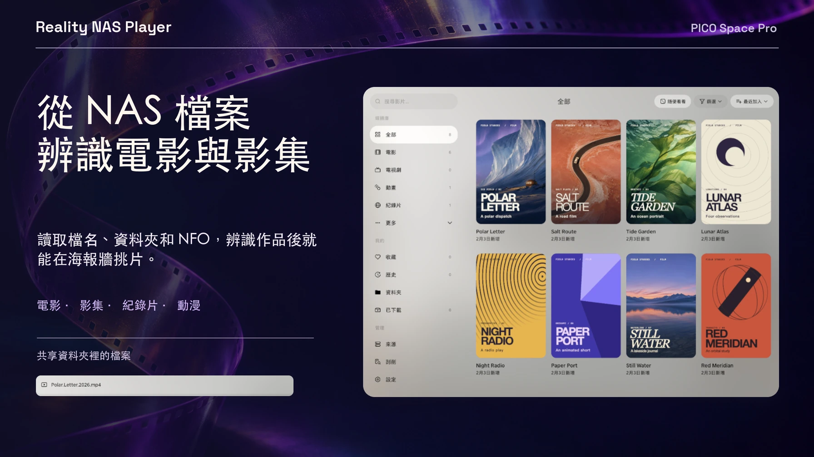
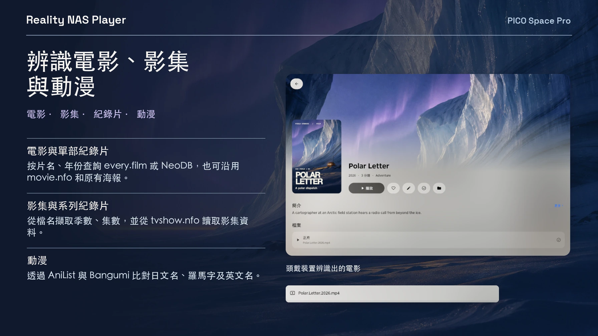
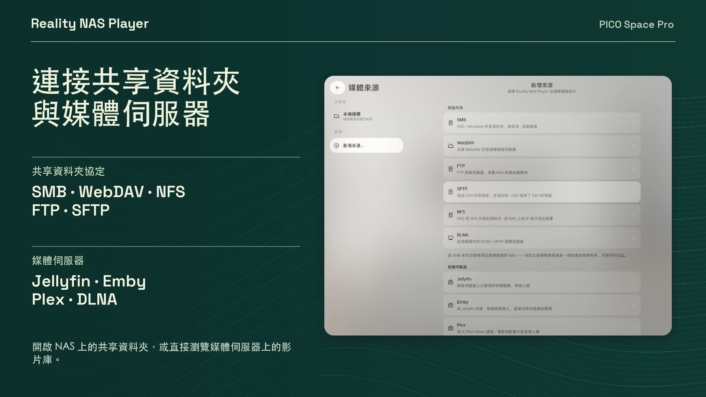
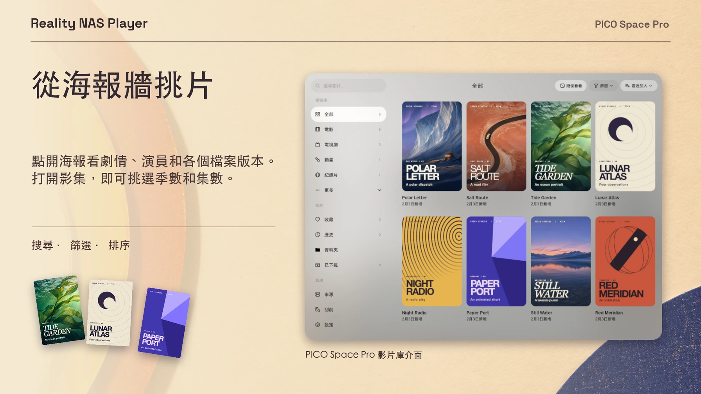
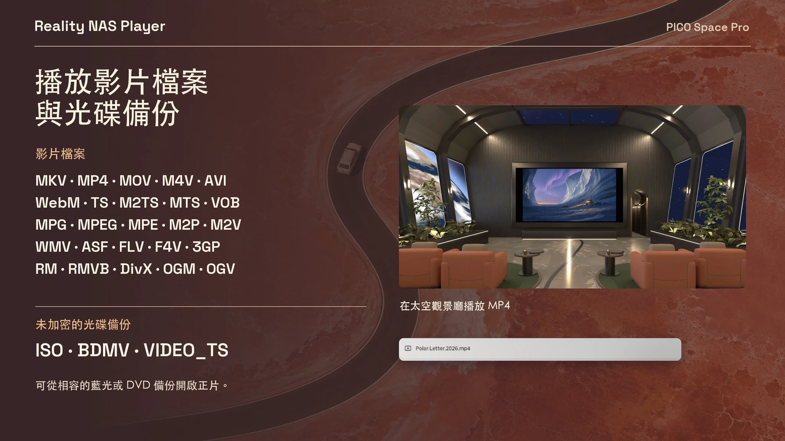
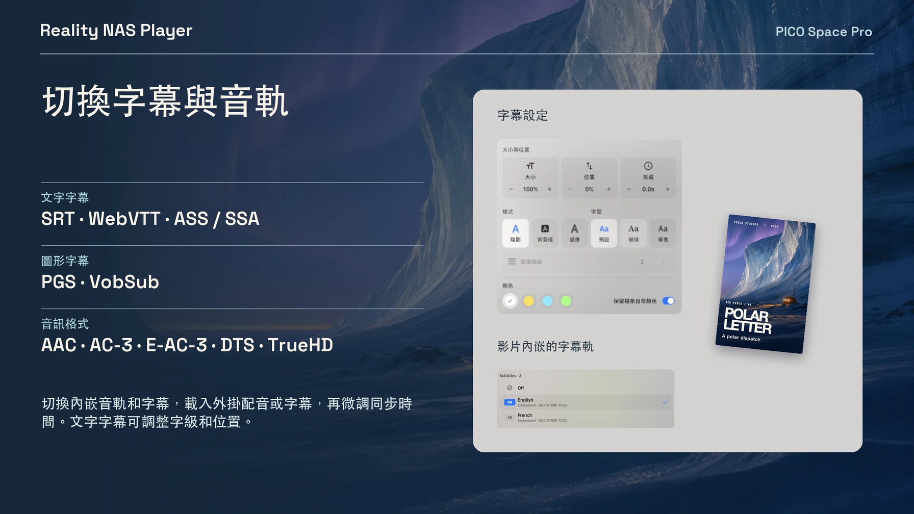
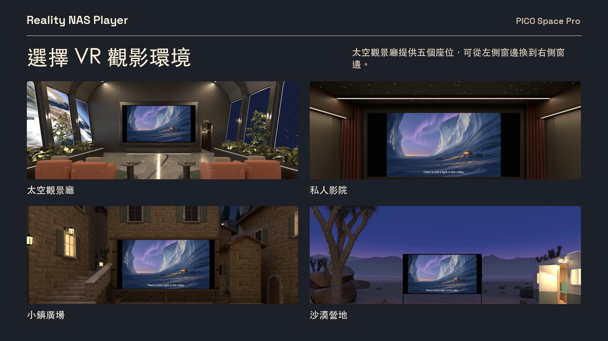
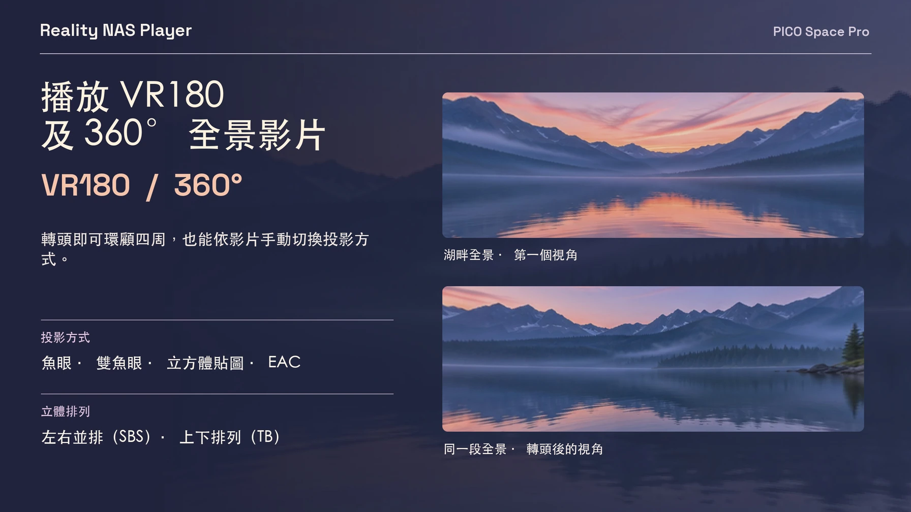

# Reality NAS Player

為 **PICO Space Pro** 設計。辨識電影、影集、紀錄片與動畫，在海報牆上選片。

[English](../../README.md) · [简体中文](zh-Hans.md) · **繁體中文** · [日本語](ja.md) · [한국어](ko.md) · [Español](es.md) · [Deutsch](de.md) · [Français](fr.md) · [🌐 23](README.md)

[下載正式簽署的 APK · v1.2.1](https://github.com/jason-jm/reality-nas-player/releases/download/v1.2.1/reality-nas-player-1.2.1-9.apk) · [官網](https://jason-jm.github.io/reality-nas-player/zh.html) · [▶ 0:31](https://jason-jm.github.io/reality-nas-player/zh.html?watch=1)

## 辨識電影、影集、紀錄片和動畫

檔名只有 video1.mkv 時，可從上一層資料夾取得片名與年份。電影和單部紀錄片可查 every.film、NeoDB，無須申請 API 金鑰。影集和系列紀錄片依季、集數整理，也會讀取既有的 tvshow.nfo。動畫由 AniList 和 Bangumi 協助比對。原有的 Kodi 海報、手動更正的配對都能保留。

在已公開的 NAS 電影測試中，**267 部電影辨識正確 266 部**，每部均取得海報，另有 1 部待辨識，錯配 0 部。[電影測試與評分方式](https://github.com/jason-jm/reality-nas-player/blob/v1.1.0/docs/keyless-verification.md)

影集和系列紀錄片可透過 TVmaze 等公開資料庫比對，無須 API 金鑰。動畫支援離線比對多語片名。WebDAV 可掃描更大的片庫，並依檔案大小選取原盤正片。 [1.2.0](https://github.com/jason-jm/reality-nas-player/releases/tag/v1.2.0)

## 連接 NAS 或家中的媒體伺服器

用 SMB、WebDAV、NFS、FTP 或 SFTP 開啟共享資料夾。也可以瀏覽區域網路上的 DLNA 裝置，或讀取 Jellyfin、Emby、Plex 媒體庫。

## 在海報牆挑版本、選集數

點一張海報即可查看劇情、演員，以及自己收藏的各個檔案版本。影集可依季選集，還沒看完的電影則可從上次的進度繼續。

## 影片格式、字幕與音軌

可掃描的影片檔包括 MKV, MP4, M4V, MOV, AVI, WebM, TS, M2TS, MTS, MPG, MPEG, MPE, M2P, M2V, VOB, WMV, ASF, RM, RMVB, FLV, F4V, OGM, OGV, DivX, 3GP。支援播放相容且未加密的藍光或 DVD 備份正片（ISO、BDMV、VIDEO_TS）。字幕支援 SRT、WebVTT、ASS/SSA、PGS、VobSub，可切換字幕、調整文字大小與顯示時間。也能切換音軌、載入外掛配音，並解碼 DTS、TrueHD 音訊。

實際播放取決於檔案中的影像編碼、規格、解析度和頭戴裝置的解碼能力。ISO、BDMV 和 VIDEO_TS 可讀取相容且未加密的藍光或 DVD 備份正片。

## 四個 VR 觀影空間

太空觀景廳可選五個座位，兩側都有靠窗座。也可切換到私人影院、小鎮廣場或沙漠營地，讓影片在場景裡的銀幕上播放。

## 播放 VR180 與 360° 全景影片

轉頭即可環顧畫面。支援左右、上下立體排列，以及魚眼和立方體貼圖。播放器可讀取投影資訊，也能手動選擇投影與立體模式。

也可預先下載影片到頭戴裝置，透過自己的 SMB 共享資料夾同步觀看進度、收藏與比對修正。macOS 和 Windows 桌面版可從原始碼建置。 [從原始碼建置桌面版](../build.md)

[下載正式簽署的 APK · v1.2.1](https://github.com/jason-jm/reality-nas-player/releases/download/v1.2.1/reality-nas-player-1.2.1-9.apk) · [GitHub Releases](https://github.com/jason-jm/reality-nas-player/releases) · [MIT](https://github.com/jason-jm/reality-nas-player/blob/main/LICENSE) · [🌐 23](README.md)
